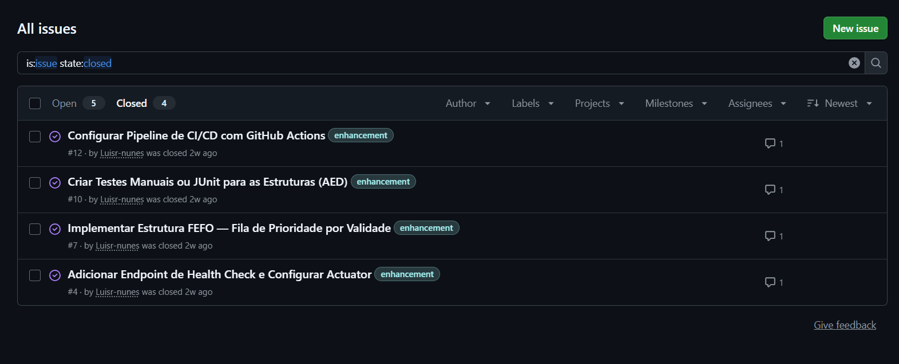
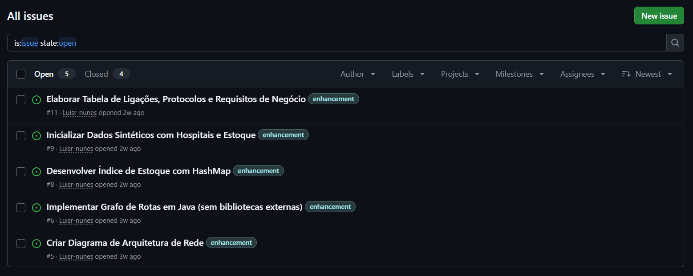
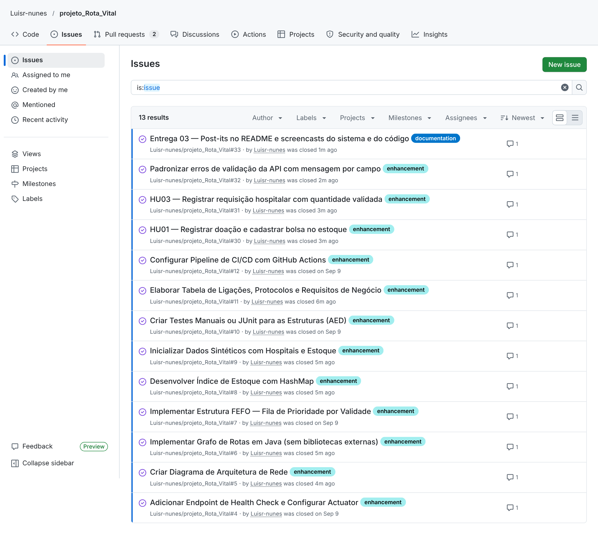

<h1 align="center">Rota Vital</h1>

<p align="center">
  <b>Gestão e distribuição de hemocomponentes na rede de sangue</b>
</p>

<p align="center">
  
  
  
  
  
</p>

<p align="center">
  <a href="#sobre-o-projeto">Sobre</a> •
  <a href="#problema">Problema</a> •
  <a href="#solução">Solução</a> •
  <a href="#tecnologias-utilizadas">Tecnologias</a> •
  <a href="#como-rodar-o-projeto">Como Rodar</a> •
  <a href="#entregas">Entregas</a> •
  <a href="#equipe">Equipe</a>
</p>

---

## Sobre o Projeto

O **Rota Vital** é o Projeto Integrador do 3º semestre do curso de **Análise e Desenvolvimento de Sistemas** da **CESAR School (2026.2)**. Trata-se de uma aplicação web em **Java/Spring Boot** que apoia a rede de sangue na **gestão e distribuição de hemocomponentes**.

O sistema é inspirado no fluxo da **Hemorrede/SUS** (centros de coleta e doação → hemocentro de processamento e controle → estoque → hospitais) e utiliza exclusivamente **dados sintéticos**.

### Disciplinas envolvidas

| Disciplina | Contribuição no Projeto |
|---|---|
| **Programação Orientada a Objetos (POO)** | Núcleo da aplicação web em Java/Spring Boot |
| **Algoritmos e Estruturas de Dados (AED)** | Roteirização (Dijkstra), compatibilidade ABO/Rh, FEFO |
| **Estatística e Probabilidade (EST)** | Indicadores, painéis e análise probabilística |
| **Infraestrutura de Software (SO)** | CI/CD, deploy em nuvem, concorrência (threads) |
| **Infraestrutura de Comunicação (RSD)** | Arquitetura de rede, telemetria, monitoramento |
| **Projeto 3** | Gestão de processo, integração e apresentação final |

---

## Problema

A rede de sangue precisa garantir o **componente certo** (compatível e dentro da validade), **no lugar certo**, **no tempo certo** e **na temperatura certa**. Falhas nesse processo geram:

- Desabastecimento de hemocomponentes
- Descarte por vencimento de validade
- Risco direto ao paciente

**Falta uma plataforma que integre estoque, compatibilidade, roteirização e monitoramento da cadeia fria.**

---

## Solução

O **Rota Vital** é uma aplicação web que:

- **Gerencia o estoque** de hemocomponentes por tipo e componente sanguíneo
- **Recebe requisições** dos hospitais
- **Aloca bolsas compatíveis** (ABO/Rh) priorizando a validade (**FEFO** — *First Expired, First Out*)
- **Calcula rotas de distribuição** respeitando a cadeia fria e as janelas de tempo (Dijkstra)
- **Monitora temperatura e rede** em painéis de indicadores

---

## Tecnologias Utilizadas

| Tecnologia | Uso |
|---|---|
| **Java** | Linguagem principal |
| **Spring Boot** | Framework web (Controllers, Services, Repositories) |
| **HTML / CSS** | Interface web (Thymeleaf ou API REST + Frontend) |
| **Banco de Dados** | Persistência de dados (a definir pela equipe) |
| [**Jira**](https://csprj-adsr-3p-e5.atlassian.net/browse/PI2) | Gestão e controle de atividades do projeto — [quadro do projeto](https://csprj-adsr-3p-e5.atlassian.net/browse/PI2) |
| **GitHub** | Versionamento de código e Issue/Bug Tracker |
| **Figma** | Prototipação Lo-Fi |
| **YouTube** | Screencasts das entregas |

> **Observação:** O uso de Lombok ou qualquer outro mecanismo de geração de código boilerplate **NÃO é permitido**.

---

## Como Rodar o Projeto

### Pré-requisitos
- **Java 17+** (JDK 17 ou superior)
- **Maven 3.8+** (ou através de extensão na sua IDE — VS Code, IntelliJ IDEA ou Eclipse)
- **Git**

### Passo a Passo de Execução

1. **Clone o repositório:**
   ```bash
   git clone https://github.com/Luisr-nunes/projeto_Rota_Vital.git
   ```

2. **Acesse o diretório do backend:**
   ```bash
   cd projeto_Rota_Vital/rotavital
   ```

3. **Execute a aplicação:**
   * **Via Maven:**
     ```bash
     mvn spring-boot:run
     ```
   * **Ou gerando o pacote JAR e executando:**
     ```bash
     mvn clean package -DskipTests
     java -jar target/hemorede-0.0.1-SNAPSHOT.jar
     ```

### Acessos e Endpoints Principais
* **Aplicação / Base API:** `http://localhost:8080`
* **Painel Web de Indicadores:** `http://localhost:8080/indicadores.html`
* **Health Check (Spring Boot Actuator):** `http://localhost:8080/actuator/health`
* **Console H2 (Banco em Memória):** `http://localhost:8080/h2-console`
  * **JDBC URL:** `jdbc:h2:mem:hemorede`
  * **Usuário:** `sa`
  * **Senha:** *(vazia)*

### Como rodar com Docker

Sobe a API e o PostgreSQL juntos, sem instalar Java, Maven nem banco na máquina.

**Pré-requisito:** Docker com Compose v2 (`docker compose version`).

```bash
cp .env.example .env          # 1. cria o arquivo de variáveis (o .env não vai para o Git)
# edite o .env e troque POSTGRES_PASSWORD
docker compose up -d --build  # 2. constrói a imagem (roda os testes) e sobe os dois serviços
docker compose ps             # 3. db e api devem ficar "healthy"
curl http://localhost:8080/actuator/health   # {"status":"UP"}
```

Para parar: `docker compose down` (os dados continuam no volume `pgdata`). Para apagar também os dados: `docker compose down -v`.

| Variável (`.env`) | Para quê | Padrão |
|---|---|---|
| `POSTGRES_PASSWORD` | Senha do banco. **Obrigatória**: sem ela o Compose se recusa a subir | — |
| `POSTGRES_DB` / `POSTGRES_USER` | Nome do banco e do usuário | `rotavital` |
| `API_PORT` | Porta da API no seu computador | `8080` |
| `HEMOREDE_SEED_ENABLED` | Carga de dados sintéticos na primeira subida | `true` |

**Decisões deste setup** (a tabela completa está em [Decisões](#decisões)):

- **Dockerfile multi-stage:** o primeiro estágio (Maven + JDK 17) compila e roda os testes; a imagem final leva só a JRE e o `.jar`, e a aplicação roda sem ser root.
- **`depends_on` com `condition: service_healthy`:** a API só inicia depois que o Postgres responde ao `pg_isready`, evitando erro de conexão na subida.
- **Volume nomeado `pgdata`:** os dados sobrevivem a `docker compose down`.
- **Banco sem `ports`:** o Postgres só é acessível pela rede interna do Compose; só a API é exposta.
- **Segredos fora do código:** a senha vem do `.env` (ignorado pelo Git) e o `.env.example` mostra quais variáveis existem. Em produção elas ficam nas variáveis de ambiente do Render.

---

## Desafio de Infra — Container, TDD e Deploy

Entrega da disciplina de Infraestrutura de Software (Unidade 2). As seções abaixo seguem o enunciado do desafio.

Subir do zero com Docker (API + PostgreSQL): veja [Como rodar com Docker](#como-rodar-com-docker). O banco fica só na rede interna do Compose ([`compose.yaml`](compose.yaml)).

### Testes

```bash
cd rotavital
mvn clean test      # rápido: unitários, integração com H2 e BDD. Não precisa de Docker
mvn clean verify    # tudo isso + testes *IT com PostgreSQL real (Testcontainers). Precisa de Docker rodando
```

| Nível | O que cobre | Onde |
|---|---|---|
| Unitário | Estruturas de AED (FEFO, índice de estoque, grafo/Dijkstra), intervalo entre doações, indicadores e telemetria | `src/test/java/.../algoritmos`, `estruturas`, `service` |
| Integração (Spring Boot + banco H2) | Endpoints de doação, requisição, estoque, rotas, indicadores e o fluxo de alocação gravando no banco | `src/test/java/.../controller`, `RequisicaoFluxoIntegrationTest` |
| Integração com PostgreSQL real (Testcontainers) | Fluxo de requisição e alocação (ABO/Rh, FEFO, validade, rollback) conferido com SQL direto no Postgres, API de aprovação (200 e 422) e carga de dados sintéticos | `src/test/java/.../integration` (`*IT`, rodam com `mvn verify`) |
| Aceitação (BDD em Gherkin) | HU08 (alocação compatível + FEFO + rota, 6 cenários) e HU06 (confirmação de entrega, escrita antes do código) | `src/test/resources/features`, runner `AceitacaoBddTest` |

- Os testes `*IT` sobem um container `postgres:16-alpine` (a mesma imagem do `compose.yaml`) e o compartilham entre as classes. Rodam pelo Maven Failsafe, por isso só entram no `mvn verify`.

- Story map, histórias da Release 1 quebradas em tarefas, regras testadas primeiro e o que ficou sem teste: [`doc/desafio-infra/story-map.md`](doc/desafio-infra/story-map.md).
- Detalhes dos cenários BDD: [`doc/testes-bdd.md`](doc/testes-bdd.md).
- Histórico red → green: commits `test:` antes do `feat:` correspondente (convenção adotada a partir da sprint 12e13).

### Pipeline e deploy

```text
pull request ──> GitHub Actions: mvn verify (unitários + H2 + BDD + PostgreSQL/Testcontainers) ──> vermelho marca o PR como falho
merge na main ─> GitHub Actions: mvn verify ──> verde
              └> Render: docker build (roda mvn verify -DskipITs) ──> teste falhou: deploy falha e a versão anterior fica no ar
                                                                  └> passou: nova versão no ar
```

- **Ferramenta:** GitHub Actions (`.github/workflows/ci.yml`), rodando em `push` e `pull_request`.
- **Gate no PR:** o check `build-and-test` roda `mvn -B verify` em todo pull request para a `main`, incluindo os testes com PostgreSQL real (Testcontainers, PI2-191). Demonstrado no PR #36: run #58 vermelho (erro proposital no intervalo de doação), run #59 verde depois da correção.
- **Gate no deploy:** o `rotavital/Dockerfile` roda `mvn -B verify -DskipITs` no build. Se um teste falhar, o Render não gera a imagem e a versão anterior continua no ar. Os `*IT` ficam de fora ali porque não há Docker dentro de um `docker build`; eles só barram o deploy se o Render esperar o CI (veja o próximo item).
- **Deploy:** Render com Auto-Deploy a cada commit na `main` (run #60 → deploy `b14e58c` live em 20/10).
- **URL no ar:** https://rota-vital-jnmx.onrender.com
- **Falta ligar (dono do repositório e do Render):** proteção da `main` exigindo o check `build-and-test` (hoje o GitHub ainda permite o merge com o check vermelho), Auto-Deploy "After CI Checks Pass" e Health Check Path `/actuator/health` no Render. Sem o "After CI Checks Pass", um teste `*IT` vermelho no GitHub Actions não impede o Render de publicar.
- **Evidências** (execução vermelha, execução verde, rollback): [`doc/evidencias/`](doc/evidencias/README.md).
- **Rollback:** Render → Events → Rollback, ou `git revert <hash>` + push. Passo a passo em [`doc/pipeline-deploy.md`](doc/pipeline-deploy.md).

### Decisões

| Decisão | Escolha | Alternativas | Por quê |
|---|---|---|---|
| Imagem base | `maven:3.9-eclipse-temurin-17` no build e `eclipse-temurin:17-jre` no runtime | `openjdk:17`, `amazoncorretto:17` | Multi-stage: o primeiro estágio compila e roda os testes (`mvn verify`); a imagem final leva só a JRE e o `.jar`, roda com usuário sem privilégios e fica menor e com menos pacotes vulneráveis. |
| Dados | PostgreSQL (Supabase em produção, container no Compose) com volume nomeado | MySQL, MongoDB; bind mount | Modelo relacional (bolsa, doador, requisição, rota); o volume nomeado mantém os dados após `docker compose down`. |
| Banco nos testes | H2 em memória nos testes rápidos (`mvn test`) e PostgreSQL real via Testcontainers nos `*IT` (`mvn verify`) | Só H2; Postgres instalado na máquina ou no runner | O H2 dá feedback em segundos, mas não é o banco de produção: o Postgres de verdade pega diferença de schema, enum e transação. O Testcontainers sobe o mesmo `postgres:16-alpine` do Compose, sem instalar nada. O custo é precisar de Docker para o `verify`. |
| Testes | Compatibilidade ABO/Rh e FEFO primeiro | Começar pelas telas ou pelo CRUD | Um erro de compatibilidade põe um paciente em risco; um erro de validade aumenta o descarte. |
| Fluxo de branch | GitHub Flow: branch curta por tarefa, pull request e `main` protegida | Git Flow, GitLab Flow | Grupo pequeno, uma versão no ar e deploy a cada merge; Git Flow teria branches demais para o tamanho do projeto. |
| CI/CD e deploy | GitHub Actions + Render | GitLab CI, Jenkins; Railway, Fly.io | O código já está no GitHub; o Render tem plano gratuito com deploy por Dockerfile, e o `mvn verify` no build impede publicar versão com teste falhando. |
| Segredos | Senha do banco nas variáveis de ambiente do Render e nos GitHub Secrets; `.env.example` no repositório e `.env` no `.gitignore` | Arquivo de configuração versionado | Nenhuma credencial no histórico do Git; quem clona sabe quais variáveis precisa. |

### Uso de IA

A equipe usou o **Claude (Anthropic)** como assistente. A IA rascunha; a equipe revisa, testa e assina cada entrega.

| Para quê | Prompt principal (resumo) | Como foi revisado |
|---|---|---|
| Planejamento das sprints e do Jira | "Faça o levantamento do que os professores pediram e distribua as tarefas de forma igual entre os 7 membros, com commits diários." | O Gerente de Projetos ajustou a distribuição e os prazos com o grupo. |
| Screencasts da Entrega 03 | "Grave o screencast do sistema e do código das HU01 e HU03, com legenda." | Vídeos assistidos e aprovados antes de publicar no YouTube. |
| Documentação do desafio | "Monte o story map da Release 1 e as seções Testes, Pipeline e deploy, Decisões e Uso de IA do README a partir do que existe no repositório." | Conferido com o código, os testes e o pipeline reais; itens pendentes marcados como pendentes. |
| Testes e código | Pedidos pontuais de testes e correções (por exemplo, mensagens de validação por campo). | Todo código passou pela suíte (`mvn test`) antes do commit. |

---

## Entregas

### Entrega 01

**Data de entrega:** 31/08/2026

#### Artefatos

- [✅] **Histórias de Usuário** — Mínimo de 7 histórias bem definidas (formato BDD, arquivo `.md` no GitHub)
  - [Link para as Histórias](doc/historias_de_usuario.md)
- [✅] **Protótipo Lo-Fi (Figma)** — Mínimo de 5 histórias prototipadas
  - [Link para o Figma](https://www.figma.com/site/snA4pKexELM7gW9JGih8iu/rota-vital-lofi?t=bL7QBDZxJXV2m1Pe-6)
- [✅] **Screencast do Protótipo** — Vídeo no YouTube explicando o protótipo Figma (com áudio ou legenda)
  - [Assistir no YouTube](https://www.youtube.com/watch?v=-Tl4rPthJ5Q) <!-- inserir link do YouTube -->

---

### Entrega 02

**Data de entrega:** 21/09/2026

#### Histórias Implementadas

```
┌─────────────────────────────────────────────────────────────────────────────┐
│ 📌 POST-IT 1 — HU04: Alocar bolsas compatíveis por FEFO                     │
├─────────────────────────────────────────────────────────────────────────────┤
│ 👤 COMO: Profissional do hemocentro                                         │
│ 🎯 QUERO: Alocar bolsas de sangue compatíveis a uma requisição hospitalar,  │
│           priorizando estritamente as de validade mais próxima              │
│ 💡 PARA QUE: Seja possível atender aos hospitais com segurança e reduzir o  │
│              descarte de hemocomponentes por vencimento                     │
├─────────────────────────────────────────────────────────────────────────────┤
│ 📋 CRITÉRIOS DE ACEITE & REGRAS DE NEGÓCIO:                                 │
│  • Apenas bolsas compatíveis (matriz ABO/Rh) e dentro da validade são       │
│    alocadas.                                                                │
│  • Ordenação FEFO (First Expired, First Out) via Min-Heap (FilaFEFO).       │
│  • A bolsa alocada passa para o status RESERVADA.                           │
│  • Caso o estoque não supra a quantidade total solicitada, a transação      │
│    é revertida (rollback) e a requisição permanece com status PENDENTE.     │
│ 💻 Módulos: RequisicaoController, RequisicaoService, AlocacaoService,        │
│             FilaFEFO, IndiceEstoque, BolsaRepository.                       │
└─────────────────────────────────────────────────────────────────────────────┘
```

```
┌─────────────────────────────────────────────────────────────────────────────┐
│ 📌 POST-IT 2 — HU05: Planejar rota de entrega de menor custo                │
├─────────────────────────────────────────────────────────────────────────────┤
│ 👤 COMO: Operador de logística da Hemorrede                                 │
│ 🎯 QUERO: Calcular a rota de menor custo (tempo/distância) do Hemocentro    │
│           até o hospital solicitante                                        │
│ 💡 PARA QUE: A entrega de hemocomponentes seja rápida, eficiente e          │
│              respeite a cadeia de temperatura de transporte                 │
├─────────────────────────────────────────────────────────────────────────────┤
│ 📋 CRITÉRIOS DE ACEITE & REGRAS DE NEGÓCIO:                                 │
│  • Roteirização parte obrigatoriamente do Hemocentro (N0) para o hospital.  │
│  • Menor caminho computado pelo algoritmo de Dijkstra manual sobre a        │
│    malha viária sintética de 6 nós (N0 a N5).                               │
│  • Retorno com nós visitados, distância total (km) e tempo estimado (min).  │
│  • Se o hospital não possuir nó alcançável no grafo, retorna HTTP 422       │
│    (RotaIndisponivelException).                                             │
│ 💻 Módulos: RotaController (POST /api/rotas/calcular), RoteirizacaoService,  │
│             GrafoRotas, DadosSinteticos.                                    │
└─────────────────────────────────────────────────────────────────────────────┘
```

#### Artefatos

- [x] Ao menos **2 histórias implementadas** (Spring Boot rodando com **HU04** e **HU05**)
- [x] **Ambiente de versionamento atuante** (commits frequentes de código semanais na branch principal `main`)
- [x] **Issue/Bug Tracker atualizado (GitHub Issues)**
  - *Histórico de Issues Fechadas:*
    
    

  - *Issues Abertas / Backlog das Sprints:*
    
    

- [x] **Screencast do sistema** — Vídeo no YouTube demonstrando as histórias implementadas
  - [Assistir no YouTube](https://youtu.be/GGAWzfbqRF8)
- [x] **Screencast do código** — Vídeo no YouTube explicando o código Spring Boot (legenda embutida via CC)
  - [Assistir no YouTube](https://youtu.be/SCN13gswS3U)

---

### Entrega U1

**Fechamento integrado da Unidade 1 — Sprint 08e09 (21/09 a 02/10/2026)**

#### Links de evidência

| Item | Link |
|------|------|
| Screencast do sistema (U1) | ⏳ pendente — PI2-131 (depende do deploy no Render) |
| Screencast do código | [Assistir no YouTube](https://youtu.be/SCN13gswS3U) |
| URL de produção (Render) | [rota-vital-jnmx.onrender.com](https://rota-vital-jnmx.onrender.com) ([health](https://rota-vital-jnmx.onrender.com/actuator/health)) |
| Board Jira | [csprj-adsr-3p-e5.atlassian.net/browse/PI2](https://csprj-adsr-3p-e5.atlassian.net/browse/PI2) |
| Histórias de usuário | [doc/historias_de_usuario.md](doc/historias_de_usuario.md) |
| Protótipo Lo-Fi (Figma) | [Abrir no Figma](https://www.figma.com/site/snA4pKexELM7gW9JGih8iu/rota-vital-lofi?t=bL7QBDZxJXV2m1Pe-6) |
| Screencast do protótipo | [Assistir no YouTube](https://www.youtube.com/watch?v=-Tl4rPthJ5Q) |

#### Evidências por disciplina

| Disciplina | Evidência |
|------------|-----------|
| **POO** | Controllers REST em [`rotavital/src/main/java/com/hemorede/controller`](rotavital/src/main/java/com/hemorede/controller) e testes de integração em [`rotavital/src/test/java/com/hemorede`](rotavital/src/test/java/com/hemorede) (HU01 doação, HU03 requisição, HU05 rota, indicadores) |
| **AED** | **Entrega U1:** estruturas em C com malloc/free em [`aed/u1/c`](aed/u1/c), reimplementação Java em [`com.hemorede.estruturas`](rotavital/src/main/java/com/hemorede/estruturas) e [tradução comentada C → Java](doc/aed-u1/Relatorio_AED_U1_Rota_Vital.pdf). Material de apoio: [complexidade Big-O](doc/aed-complexidade.md) e [escopo do grafo](doc/escopo-grafo.md) |
| **EST** | [Relatório de análise descritiva](doc/relatorio-analise-descritiva-u1.md) e [indicadores estatísticos](doc/indicadores-estatisticos.md) |
| **SO** | [Relatório histórico com threads](rotavital/doc/entrega-so-concorrencia.md), [pipeline CI/CD](.github/workflows/ci.yml) e [documentação do pipeline e do deploy](doc/pipeline-deploy.md) |
| **RSD** | [Topologia de rede](doc/topologia.md) (com URL de produção e canal de telemetria), [contratos de API](doc/contratos-api.md) e [canal de telemetria](doc/telemetria.md) — endpoint `GET /api/telemetria/temperatura` |

---

### Entrega 03

**Data de entrega:** 19/10/2026

#### Histórias Implementadas

```
┌─────────────────────────────────────────────────────────────────────────────┐
│ 📌 POST-IT 1 — HU01: Registrar doação e cadastrar bolsa no estoque          │
├─────────────────────────────────────────────────────────────────────────────┤
│ 👤 COMO: Atendente do hemocentro                                            │
│ 🎯 QUERO: Registrar uma doação e cadastrar a bolsa coletada                 │
│ 💡 PARA QUE: A bolsa fique disponível no estoque para atender os hospitais  │
├─────────────────────────────────────────────────────────────────────────────┤
│ 📋 CRITÉRIOS DE ACEITE & REGRAS DE NEGÓCIO:                                 │
│  • O doador informado deve existir e estar ativo (inativo → HTTP 422).      │
│  • Intervalo mínimo de 60 dias entre doações do mesmo doador (HTTP 422).    │
│  • Doação e bolsa são salvas na mesma transação (@Transactional).           │
│  • A bolsa entra no estoque com status DISPONIVEL.                          │
│  • Coleta não pode estar no futuro e a validade deve ser futura (HTTP 400). │
│ 💻 Módulos: DoacaoController (POST /api/doacoes), DoacaoService,            │
│             DoacaoRequest, Bolsa (Builder), DoadorController, index.html.   │
└─────────────────────────────────────────────────────────────────────────────┘
```

```
┌─────────────────────────────────────────────────────────────────────────────┐
│ 📌 POST-IT 2 — HU03: Registrar requisição hospitalar                        │
├─────────────────────────────────────────────────────────────────────────────┤
│ 👤 COMO: Profissional de um hospital                                        │
│ 🎯 QUERO: Solicitar hemocomponentes informando tipo, quantidade e prioridade│
│ 💡 PARA QUE: O hemocentro possa atender à necessidade do hospital           │
├─────────────────────────────────────────────────────────────────────────────┤
│ 📋 CRITÉRIOS DE ACEITE & REGRAS DE NEGÓCIO:                                 │
│  • A requisição deve estar vinculada a um hospital existente (HTTP 404).    │
│  • A quantidade deve ser maior que zero (HTTP 400 com a mensagem do campo). │
│  • A requisição é salva com status PENDENTE e recebe um identificador.      │
│  • Status e data da solicitação são definidos pelo servidor.                │
│ 💻 Módulos: RequisicaoController (POST /api/requisicoes),                   │
│             RequisicaoService, RequisicaoRequest, ItemRequisicaoRequest,    │
│             GlobalExceptionHandler, index.html.                             │
└─────────────────────────────────────────────────────────────────────────────┘
```

#### Artefatos

- [x] Mais **2 histórias implementadas** (**HU01** e **HU03**, lendo e gravando no banco)
- [x] Commits frequentes de código (mínimo semanais) direto na `main`
- [x] **Issue/Bug Tracker atualizado (GitHub Issues)**
  - *Print do Bug Tracker:*

    

- [x] **Screencast do sistema** — HU01 e HU03 rodando, com legenda embutida
  - [Assistir no YouTube](https://www.youtube.com/watch?v=YsbCOH_n_zY)
- [x] **Screencast do código** — Explicação do código de HU01 e HU03, com legenda embutida
  - [Assistir no YouTube](https://www.youtube.com/watch?v=5QhViFcMsw4)

---

### Entrega 04

**Data de entrega:** 09/11/2026

#### Histórias Implementadas

> *Adicionar aqui a descrição (formato POST-IT) das histórias implementadas nesta entrega.*

#### Artefatos

- [ ] Implementação das **histórias restantes** (mínimo de 2)
- [ ] Commits frequentes (mínimo semanais)
- [ ] Issue/Bug Tracker atualizado
  - *Print do Bug Tracker:* <!-- inserir screenshot -->
- [ ] **Screencast do sistema** — Ênfase nas novas histórias (com áudio ou legenda)
  - [Assistir no YouTube](#) <!-- inserir link -->
- [ ] **Screencast do código** — Explicação do código das histórias implementadas (com áudio ou legenda)
  - [Assistir no YouTube](#) <!-- inserir link -->

---

### Apresentação Final

**Data:** 09/11 a 13/11/2026 (dia da aula)

Resumo de até **8 minutos** abordando:

| Tópico | Descrição |
|---|---|
| **O Problema** | O que o produto busca resolver |
| **A Solução** | Características, público-alvo, histórias implementadas, diferencial |
| **Fluxo de Trabalho** | Planejamento, requisitos, desenvolvimento, gerência de configuração, testes |
| **Ferramentas** | Ferramentas utilizadas (incluindo links) |
| **Lições Aprendidas** | O que aprendemos com o processo |
| **Demonstração** | Demonstração rápida do produto funcionando |

> **Todos os membros do grupo devem estar presentes na apresentação.**

---

## Equipe

| Função | Matrícula | Responsável | E-mail |
|---|---|---|---|
| Tech Lead | 2025200261 | Lucas Henrique Gomes Medeiros | lhgm@cesar.school |
| Gerente de Projetos | 2025200183 | Luis Felipe Farias Nunes | lffn@cesar.school |
| Desenvolvedor Backend | 2025200142 | João Pedro Cavalcanti Souza | jpcs2@cesar.school |
| Desenvolvedor Backend | 2025200197 | Luis Lucena Wanderley G. | llwg@cesar.school |
| Desenvolvedor Backend | 2025200043 | Matheus Rodrigues Larré | mrl2@cesar.school |
| Engenheira de Dados | 2025200311 | Micaella Maria Barbosa Cabral | mmbc2@cesar.school |
| Desenvolvedor Frontend | 2025200139 | Mariana Xavier Bezerra | mxb@cesar.school |

---

## Histórico de Membros

| Nome | E-mail | Data de Entrada | Data de Saída | Observação |
|---|---|---|---|---|
| — | — | — | — | *Nenhuma alteração até o momento.* |

---

## Referências

- [A crash course on writing a better README](https://hackernoon.com/a-crash-course-on-writing-a-better-readme-d796d1f6b352)
- [Make a README](https://www.makeareadme.com/)
- [Hall of Fame — Sourcerer](https://github.com/sourcerer-io/hall-of-fame)

---

<p align="center">
  <b>CESAR School — ADS 2026.2 — 3º Semestre</b><br/>
  Projeto Integrador — Rota Vital
</p>

