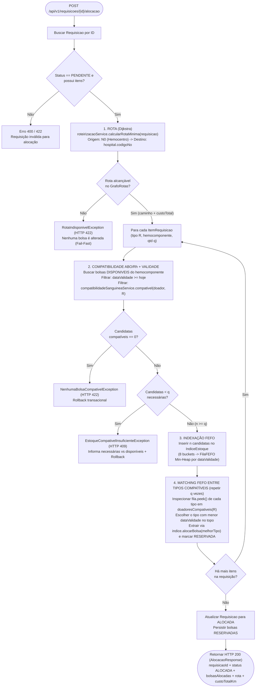
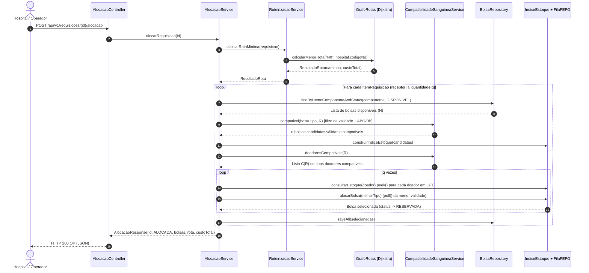

# Algoritmos e Estruturas de Dados U2 — Compatibilidade Sanguínea ABO/Rh, Complexidade do Matching e Fluxo Integrado (HU08)

**Disciplina:** Algoritmos e Estruturas de Dados (AED)
**Atividade:** PI2-167 · B4 (subtarefa da PI2-157 — HU08: Alocação por compatibilidade ABO/Rh + FEFO + rota)
**Responsável:** Matheus Rodrigues Larré
**Data:** 27/10/2026
**Relacionados:** PI2-165 (Matriz ABO/Rh 8×8), PI2-166 (Alocação devolve rota Dijkstra), PI2-145 (`AlocacaoService`), `doc/aed-complexidade.md` (Estruturas U1)

---

## 1. Objetivo e Contexto

Na Unidade 1 (`doc/aed-complexidade.md`), foram consolidadas as três estruturas fundamentais do módulo algorítmico do **Rota Vital**:
- **`FilaFEFO`** (`PriorityQueue` / Min-Heap binário ordenado pela data de validade mais próxima);
- **`IndiceEstoque`** (tabela de dispersão indexada por `TipoSanguineo`, particionando o estoque em $k = 8$ filas FEFO independentes);
- **`GrafoRotas`** (lista de adjacência + algoritmo de Dijkstra com Min-Heap para cálculo do caminho mínimo entre o Hemocentro e os hospitais).

Na **Unidade 2 (HU08 — PI2-157)**, essas três estruturas passam a operar de forma integrada com a **regra de compatibilidade transfusional ABO/Rh**: quando um hospital solicita bolsas para um receptor de determinado tipo sanguíneo, o sistema não se restringe ao tipo idêntico (*isogrupo*), mas avalia todos os tipos doadores biologicamente compatíveis (*heterogrupo*), selecionando de maneira gulosa a bolsa válida que vence primeiro (**FEFO global entre tipos compatíveis**) e acoplando o cálculo prévio da **rota de menor custo (Dijkstra)**.

Este documento registra:
1. As **regras de compatibilidade ABO/Rh adotadas** (matriz $8 \times 8$ para concentrado de hemácias) e suas fontes didáticas e normativas;
2. A **análise de complexidade assintótica (Big-O)** da consulta à matriz de compatibilidade e do algoritmo de *matching* + alocação;
3. O **diagrama e especificação do fluxo completo** `Alocacao = Compatibilidade ABO/Rh + FEFO + Rota (Dijkstra)`.

---

## 2. Regras de Compatibilidade ABO/Rh Adotadas e Fontes

### 2.1 Escopo Didático: Transfusão de Concentrado de Hemácias (Erithrócitos)

Para fins didáticos e operacionais do domínio do **Rota Vital**, a regra de compatibilidade sanguínea implementada em [`TipoSanguineo.java`](../rotavital/src/main/java/com/hemorede/domain/enums/TipoSanguineo.java) e exposta por [`CompatibilidadeSanguineaService.java`](../rotavital/src/main/java/com/hemorede/service/CompatibilidadeSanguineaService.java) adota o modelo clássico de **transfusão de concentrado de hemácias** (*packed red blood cells*):

1. **Sistema ABO (Antígenos de superfície A e B vs. Anticorpos plasmáticos anti-A e anti-B):**
   - O **doador $O$** não possui antígenos $A$ nem $B$ na membrana das hemácias, podendo doar hemácias para receptores $O, A, B$ e $AB$.
   - O **doador $A$** possui antígeno $A$, podendo doar para receptores que não possuam anticorpos anti-$A$ ($A$ e $AB$).
   - O **doador $B$** possui antígeno $B$, podendo doar para receptores que não possuam anticorpos anti-$B$ ($B$ e $AB$).
   - O **doador $AB$** possui ambos os antígenos $A$ e $B$, podendo doar hemácias exclusivamente para receptores $AB$ (receptor universal de hemácias).
2. **Fator Rh — Antígeno D ($\text{Rh}^+$ vs. $\text{Rh}^-$):**
   - Doadores $\text{Rh}^-$ (ausência do antígeno D) podem doar tanto para receptores $\text{Rh}^-$ quanto para receptores $\text{Rh}^+$.
   - Doadores $\text{Rh}^+$ (presença do antígeno D) só podem doar para receptores $\text{Rh}^+$, evitando aloimunização anti-D em pacientes $\text{Rh}^-$.

Formalmente, dados um tipo doador $D = (\text{ABO}_D, \text{Rh}_D)$ e um tipo receptor $R = (\text{ABO}_R, \text{Rh}_R)$:

$$\text{compatível}(D, R) \iff \left(\text{Antígenos}_{\text{ABO}}(D) \subseteq \text{Antígenos}_{\text{ABO}}(R)\right) \land \left(\text{Rh}_D = + \implies \text{Rh}_R = +\right)$$

### 2.2 Matriz de Compatibilidade $8 \times 8$ (Doador $\times$ Receptor)

A tabela abaixo representa a matriz booleana $M_{8 \times 8}$ onde as **linhas** correspondem ao tipo sanguíneo da bolsa **doadora** em estoque e as **colunas** correspondem ao tipo sanguíneo do **receptor** informado no item da requisição hospitalar (`1` / `✓` = compatível; `0` / `—` = incompatível):

| Doador $\downarrow$ \ Receptor $\rightarrow$ | `O-` (`O_NEG`) | `O+` (`O_POS`) | `A-` (`A_NEG`) | `A+` (`A_POS`) | `B-` (`B_NEG`) | `B+` (`B_POS`) | `AB-` (`AB_NEG`) | `AB+` (`AB_POS`) | Total de Receptores Atendidos |
| :--- | :---: | :---: | :---: | :---: | :---: | :---: | :---: | :---: | :---: |
| **`O-` (`O_NEG`) — Doador Universal** | **✓** | **✓** | **✓** | **✓** | **✓** | **✓** | **✓** | **✓** | **8 / 8** |
| **`O+` (`O_POS`)** | — | **✓** | — | **✓** | — | **✓** | — | **✓** | **4 / 8** |
| **`A-` (`A_NEG`)** | — | — | **✓** | **✓** | — | — | **✓** | **✓** | **4 / 8** |
| **`A+` (`A_POS`)** | — | — | — | **✓** | — | — | — | **✓** | **2 / 8** |
| **`B-` (`B_NEG`)** | — | — | — | — | **✓** | **✓** | **✓** | **✓** | **4 / 8** |
| **`B+` (`B_POS`)** | — | — | — | — | — | **✓** | — | **✓** | **2 / 8** |
| **`AB-` (`AB_NEG`)** | — | — | — | — | — | — | **✓** | **✓** | **2 / 8** |
| **`AB+` (`AB_POS`)** | — | — | — | — | — | — | — | **✓** | **1 / 8** |
| **Total de Tipos Doadores Aceitos** | **1** | **2** | **2** | **4** | **2** | **4** | **4** | **8 (Receptor Universal)** | **27 pares válidos de 64** |

### 2.3 Conjuntos de Doadores Compatíveis por Receptor (Visão da Alocação)

Na implementação de [`TipoSanguineo.java`](../rotavital/src/main/java/com/hemorede/domain/enums/TipoSanguineo.java#L13-L22), cada receptor $R$ mapeia diretamente para a lista de seus tipos doadores válidos $C(R)$:

| Receptor Solicitado (`ItemRequisicao`) | Conjunto de Doadores Compatíveis $C(R)$ | Cardinalidade $|C(R)|$ |
| :--- | :--- | :---: |
| **`O_NEG` (`O-`)** | `[O_NEG]` | 1 |
| **`O_POS` (`O+`)** | `[O_POS, O_NEG]` | 2 |
| **`A_NEG` (`A-`)** | `[A_NEG, O_NEG]` | 2 |
| **`A_POS` (`A+`)** | `[A_POS, A_NEG, O_POS, O_NEG]` | 4 |
| **`B_NEG` (`B-`)** | `[B_NEG, O_NEG]` | 2 |
| **`B_POS` (`B+`)** | `[B_POS, B_NEG, O_POS, O_NEG]` | 4 |
| **`AB_NEG` (`AB-`)** | `[A_NEG, B_NEG, AB_NEG, O_NEG]` | 4 |
| **`AB_POS` (`AB+`)** | `[A_POS, A_NEG, B_POS, B_NEG, AB_POS, AB_NEG, O_POS, O_NEG]` | 8 |

### 2.4 Fontes Didáticas e Normativas Adotadas

1. **Ministério da Saúde (Brasil):** *Guia para o Uso de Hemocomponentes*, 2ª edição, Secretaria de Atenção à Saúde, Departamento de Atenção Especializada e Temática (DAET), Brasília: Ministério da Saúde, 2015 — Capítulos de Transfusão de Concentrado de Hemácias e Compatibilidade ABO/RhD.
2. **Legislação Hemoterápica Brasileira:** Portaria de Consolidação MS nº 5/2017, Anexo IV (origem: Portaria MS nº 158/2016) e RDC ANVISA nº 34/2014 (*Boas Práticas no Ciclo do Sangue*).
3. **Referência Clássica de Imuno-hematologia:** Harmening, D. M. *Modern Blood Banking & Transfusion Practices*, 7th Edition, F.A. Davis Company — Tabelas de compatibilidade eritrocitária ABO e sistema Rh.
4. **Referência de Estruturas de Dados e Algoritmos:** Cormen, T. H.; Leiserson, C. E.; Rivest, R. L.; Stein, C. *Algoritmos: Teoria e Prática* (3ª ed.), Campus/Elsevier — Filas de Prioridade baseadas em Min-Heap (Cap. 6), Tabelas de Dispersão (Cap. 11) e Caminho Mínimo de Fonte Única / Algoritmo de Dijkstra (Cap. 24).

---

## 3. Complexidade da Matriz e do Matching (Big-O)

### 3.1 Variáveis de Dimensão do Problema

Para a análise assintótica formal do processo de alocação na HU08, definem-se:
- $k = |\text{TipoSanguineo}| = 8$: cardinalidade fixa e finita do domínio de tipos sanguíneos (`A+`, `A-`, `B+`, `B-`, `AB+`, `AB-`, `O+`, `O-`);
- $N$: número total de bolsas disponíveis (`StatusBolsa.DISPONIVEL`) do hemocomponente solicitado no estoque;
- $n \le N$: número de bolsas candidatas válidas (não vencidas e biologicamente compatíveis com o receptor);
- $n_t$: número de bolsas no bucket do tipo sanguíneo $t \in C(R)$ dentro do `IndiceEstoque`, tal que $\sum_{t \in C(R)} n_t = n$;
- $q$: quantidade de bolsas solicitadas no `ItemRequisicao` ($q \le n$ quando há estoque suficiente);
- $I$: quantidade de itens (`ItemRequisicao`) na `Requisicao`;
- $V, E$: número de vértices (hospitais/hemocentro) e arestas (trechos viários) do `GrafoRotas`.

### 3.2 Complexidade da Matriz de Compatibilidade ABO/Rh ($8 \times 8$)

Seja na representação matricial bidimensional `boolean[8][8]` indexada por `doador.ordinal()` e `receptor.ordinal()`, seja no mapa imutável `Map<TipoSanguineo, List<TipoSanguineo>>` em [`TipoSanguineo.java`](../rotavital/src/main/java/com/hemorede/domain/enums/TipoSanguineo.java):

| Operação | Método | Complexidade Temporal (Caso Médio e Pior Caso) | Complexidade Espacial | Justificativa |
| :--- | :--- | :---: | :---: | :--- |
| **Verificação de par $(D, R)$** | `compativel(doador, receptor)` | **$O(1)$** | $O(1)$ | Acesso direto à célula `M[doador.ordinal()][receptor.ordinal()]` ou busca em lista estática de tamanho máximo $k = 8 \implies O(1)$. |
| **Listagem de doadores de $R$** | `doadoresCompativeis(receptor)` | **$O(1)$** | $O(1)$ | Retorna referência imutável para os tipos compatíveis de $R$ ($|C(R)| \le 8$). |
| **Armazenamento da Matriz** | Inicialização estática | $O(k^2) = O(1)$ | **$O(k^2) = O(1)$** | Matriz fixa de $8 \times 8 = 64$ posições booleanas em memória constante. |

### 3.3 Complexidade do Algoritmo de Matching (Compatibilidade + FEFO)

O algoritmo de *matching* implementado em [`AlocacaoService.alocar(ItemRequisicao)`](../rotavital/src/main/java/com/hemorede/service/AlocacaoService.java#L97-L179) executa quatro etapas bem definidas para cada item da requisição:

#### Etapa 1 — Triagem de Candidatas Válidas e Compatíveis (`buscarCandidatasValidas`)
Percorre as $N$ bolsas disponíveis do hemocomponente, descartando bolsas vencidas (`dataValidade < hoje`) e bolsas incompatíveis segundo `compatibilidadeSanguineaService.compativel(bolsa.tipo, item.tipo)`:
- Como cada teste de validade e de compatibilidade ABO/Rh custa $O(1)$, a filtragem linear custa:
  $$T_{\text{filtro}}(N) = O(N)$$

#### Etapa 2 — Construção do Índice Particionado FEFO (`construirIndiceEstoque`)
Insere cada uma das $n$ bolsas compatíveis no [`IndiceEstoque`](../rotavital/src/main/java/com/hemorede/algoritmos/IndiceEstoque.java), que localiza o bucket do `TipoSanguineo` em $O(1)$ e insere a bolsa na respectiva [`FilaFEFO`](../rotavital/src/main/java/com/hemorede/algoritmos/FilaFEFO.java) (Min-Heap binário por `dataValidade`) em $O(\log n_t)$:
- Custo acumulado de indexação das $n$ bolsas:
  $$T_{\text{index}}(n) = \sum_{t \in C(R)} O(n_t \log n_t) \le O(n \log n)$$

#### Etapa 3 — Seleção Gulosa FEFO Entre Tipos Compatíveis (`alocarProximaCompativel`)
Para escolher **1 bolsa** dentre todos os tipos doadores compatíveis $C(R)$ garantindo que saia a bolsa de **menor data de validade global**:
1. Inspeciona o topo (`fila.peek()`, custo $O(1)$) de cada uma das $|C(R)| \le k = 8$ filas compatíveis: custo $O(k) = O(1)$.
2. Identifica o tipo `melhorTipo` cuja bolsa no topo possui a menor `dataValidade` (política FEFO estrita, exemplificada no cenário BDD em que uma bolsa `O_NEG` vencendo em 2 dias tem prioridade sobre uma `A_POS` vencendo em 10 dias para um receptor `A_POS`).
3. Extrai a raiz do Min-Heap vencedor via `indice.alocarBolsa(melhorTipo)` (`poll()`), recompondo o heap em $O(\log n_{\text{melhorTipo}}) \le O(\log n)$.

Para alocar as $q$ bolsas solicitadas no item:
$$T_{\text{seleção}}(q, n) = q \cdot \left(O(k) + O(\log n)\right) = O(q \log n) \quad (\text{visto que } k = 8 \text{ é constante})$$

#### Etapa 4 — Cálculo da Rota Mínima via Dijkstra (`calcularRotaMinima`)
Antes de reservar qualquer bolsa no banco, [`AlocacaoService.alocarRequisicao`](../rotavital/src/main/java/com/hemorede/service/AlocacaoService.java#L70) aciona [`RoteirizacaoService.calcularRotaMinima`](../rotavital/src/main/java/com/hemorede/service/RoteirizacaoService.java#L79-L97), executando o algoritmo de Dijkstra com Min-Heap sobre o `GrafoRotas`:
$$T_{\text{rota}}(V, E) = O((V + E) \log V)$$

### 3.4 Tabela Consolidada de Complexidade Temporal e Espacial (HU08)

| Etapa / Componente | Estrutura de Dados | Complexidade de Tempo | Complexidade de Espaço |
| :--- | :--- | :---: | :---: |
| **1. Consulta de Compatibilidade ABO/Rh** | Matriz / Mapa estático $8 \times 8$ | $O(1)$ | $O(1)$ ($k^2 = 64$) |
| **2. Triagem de Bolsas Válidas e Compatíveis** | Stream sobre estoque disponível | $O(N)$ | $O(n)$ |
| **3. Indexação em Filas FEFO por Tipo** | `IndiceEstoque` ($8 \times$ `FilaFEFO` Min-Heap) | $O(n \log n)$ | $O(n)$ |
| **4. Extração de 1 Bolsa Compatível (FEFO)** | `peek()` em $\le 8$ heaps + `poll()` no menor | $O(\log n)$ | $O(1)$ |
| **5. Alocação das $q$ Bolsas de um Item** | Loop de $q$ extrações sobre `IndiceEstoque` | $O(N + n \log n + q \log n) = O(N + n \log n)$ | $O(n)$ |
| **6. Cálculo de Rota Mínima (Dijkstra)** | `GrafoRotas` (Lista de Adjacência + Min-Heap) | $O((V + E) \log V)$ | $O(V + E)$ |
| **Fluxo Completo (`alocarRequisicao`)** | **Dijkstra + Matching ABO/Rh + FEFO** | **$O\big((V + E) \log V + I \cdot (N + n \log n)\big)$** | **$O(V + E + n)$** |

> [!TIP]
> **Eficiência na Prática:** Como $q \le n \le N$, o termo dominante por item é $O(N + n \log n)$, evitando reordenações completas a cada bolsa retirada. Além disso, caso o estoque já seja mantido pré-indexado em memória no `IndiceEstoque`, a alocação de $q$ bolsas compatíveis cai diretamente para **$O(q \log n)$**, sem necessidade de varrer bolsas de tipos incompatíveis.

---

## 4. Diagrama do Fluxo: Alocação = Compatibilidade + FEFO + Rota

O endpoint `POST /api/v1/requisicoes/{id}/alocacao` ([`AlocacaoController.java`](../rotavital/src/main/java/com/hemorede/controller/AlocacaoController.java)) orquestra em uma única transação atômica (`@Transactional`) a validação da rota hospitalar via Dijkstra, a filtragem de compatibilidade ABO/Rh e a reserva FEFO das bolsas no estoque.

### 4.1 Fluxograma de Decisão e Execução (`AlocacaoService.alocarRequisicao`)

### 4.2 Diagrama de Sequência entre Componentes

---

## 5. Garantias de Invariantes, Cenários BDD e Rastreabilidade

### 5.1 Garantias Algorítmicas e Transacionais (HU08)

| Regra / Invariante | Como é garantida no código | Cenário BDD correspondente (`alocar_bolsa.feature`) |
| :--- | :--- | :--- |
| **FEFO prevalece entre todos os tipos compatíveis** | `alocarProximaCompativel` compara o `peek()` de todos os tipos em `doadoresCompativeis(receptor)` e retira a bolsa que vence mais cedo (ex.: bolsa `O_NEG` vencendo em 2 dias é alocada antes de bolsa `A_POS` vencendo em 10 dias para receptor `A_POS`). | `Reservar a bolsa compativel que vence primeiro` (HTTP 200) |
| **Bloqueio estrito de tipos incompatíveis** | `compatibilidadeSanguineaService.compativel(doador, receptor)` filtra antes da indexação; se $n = 0$, lança `NenhumaBolsaCompativelException`. | `Rejeitar estoque incompativel` (HTTP 422) |
| **Sem reserva parcial quando falta quantidade** | Verifica `candidatasCompativeis.size() < necessario` antes de alterar status e lança `EstoqueCompativelInsuficienteException`. | `Rejeitar quantidade insuficiente sem reservar parcialmente` (HTTP 409) |
| **Descarte de bolsas vencidas** | Filtro `!bolsa.getDataValidade().isBefore(hoje)` ignora bolsas com validade expirada, mesmo que o tipo sanguíneo seja compatível. | `Ignorar bolsa vencida mesmo que seja compativel` (HTTP 200) |
| **Validação prévia de rota (Fail-Fast)** | `roteirizacaoService.calcularRotaMinima(requisicao)` é executado na linha 70 de `AlocacaoService`, antes do loop de itens. Se não houver rota até o hospital, lança `RotaIndisponivelException` sem tocar no estoque. | `Nao reservar bolsas quando o hospital nao possui rota` (HTTP 422) |
| **Atomicidade entre múltiplos itens (`@Transactional`)** | Se o 1º item da requisição for alocado, mas o 2º item falhar por falta de bolsa compatível, o Spring realiza *rollback* completo da transação. | `Reverter o primeiro item quando faltar estoque para o segundo` (HTTP 422) |

### 5.2 Rastreabilidade com o Código-Fonte e Testes

- **Regras ABO/Rh e Matriz de Compatibilidade:** [`TipoSanguineo.java`](../rotavital/src/main/java/com/hemorede/domain/enums/TipoSanguineo.java) e [`CompatibilidadeSanguineaService.java`](../rotavital/src/main/java/com/hemorede/service/CompatibilidadeSanguineaService.java)
- **Estruturas AED (Fila FEFO, Índice Hash e Grafo Dijkstra):** [`FilaFEFO.java`](../rotavital/src/main/java/com/hemorede/algoritmos/FilaFEFO.java), [`IndiceEstoque.java`](../rotavital/src/main/java/com/hemorede/algoritmos/IndiceEstoque.java) e [`GrafoRotas.java`](../rotavital/src/main/java/com/hemorede/algoritmos/GrafoRotas.java)
- **Orquestração Alocação = Compatibilidade + FEFO + Rota:** [`AlocacaoService.java`](../rotavital/src/main/java/com/hemorede/service/AlocacaoService.java), [`RoteirizacaoService.java`](../rotavital/src/main/java/com/hemorede/service/RoteirizacaoService.java), [`AlocacaoController.java`](../rotavital/src/main/java/com/hemorede/controller/AlocacaoController.java) e [`AlocacaoResponse.java`](../rotavital/src/main/java/com/hemorede/dto/AlocacaoResponse.java)
- **Especificação Executável (BDD Cucumber — HU08):** [`alocar_bolsa.feature`](../rotavital/src/test/resources/features/alocar_bolsa.feature) e [`RequisicaoSteps.java`](../rotavital/src/test/java/com/hemorede/bdd/RequisicaoSteps.java)
