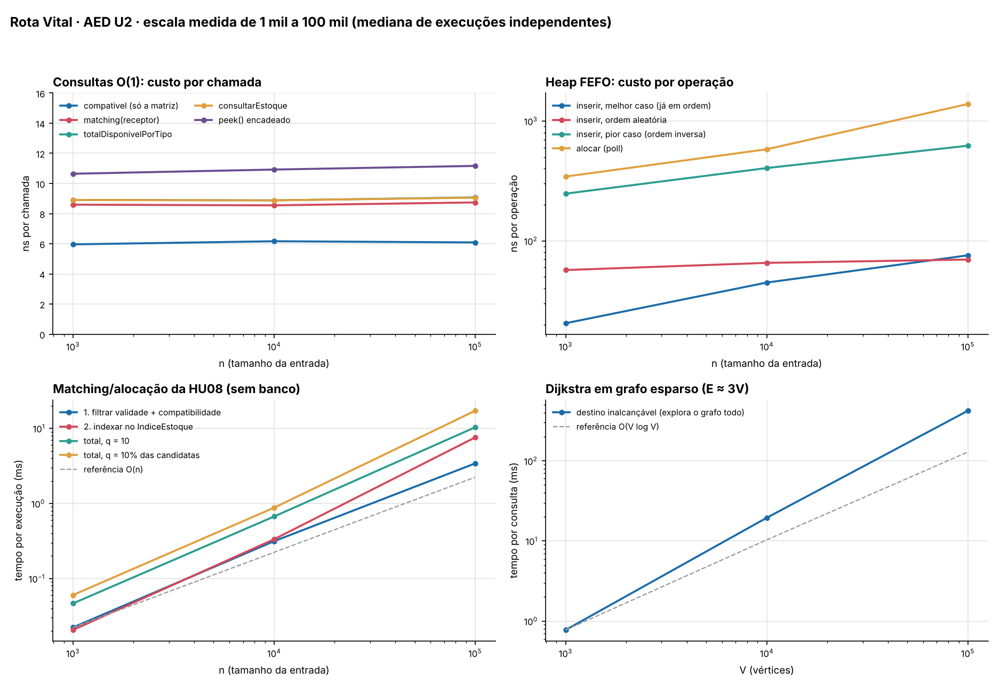

# Relatório AED U2 — Complexidade da matriz, do matching, do FEFO e do Dijkstra, com medição empírica

**Disciplina:** Algoritmos e Estruturas de Dados (AED)
**Atividade:** L1 — Relatório U2: complexidade de matriz, matching, FEFO e Dijkstra com medição empírica
**Responsável:** João Pedro
**Data:** 14/11/2026
**Relacionados:** [`aed-complexidade.md`](aed-complexidade.md) (estruturas da U1), [`aed-u2-compatibilidade.md`](aed-u2-compatibilidade.md) (matriz ABO/Rh e fluxo da HU08), [`aed/u2/`](../aed/u2) (versão em C da matriz)

Neste relatório, "matriz" é a matriz de compatibilidade ABO/Rh 8×8 (`MatrizCompatibilidade`) e "matching" é a alocação da HU08 (`AlocacaoService.alocar`): compatibilidade + FEFO entre os tipos doadores compatíveis.

---

## 1. Resumo

Cada análise de complexidade abaixo foi feita lendo o código que está na `main` e depois **conferida com medição** em 1 mil, 10 mil e 100 mil bolsas (e, para o Dijkstra, 1 mil, 10 mil e 100 mil vértices). As três execuções independentes da JVM concordaram em quase tudo: a variação entre execuções ficou em até 1,5× em 59 das 65 linhas; as 6 exceções estão marcadas com ⚠ nas tabelas.

**O que a medição confirmou**

- `MatrizCompatibilidade.compativel` e `matching`, `IndiceEstoque.totalDisponivelPorTipo`/`consultarEstoque` e `FilaFEFO.peek` são **O(1)**: o custo por chamada ficou plano de 1 mil a 100 mil (6,0 → 6,2 → 6,1 ns; 8,6 → 8,5 → 8,7 ns; 8,9 → 8,9 → 9,1 ns; 10,6 → 10,9 → 11,2 ns).
- A triagem da HU08 (filtrar validade + compatibilidade) é **linear**: 22 → 31 → 34 ns por bolsa.
- O custo total da alocação cresce um pouco acima de `n log n`: ×14,4 e ×15,4 por década, contra ×13,3 e ×12,5 previstos.

**O que a medição mostrou além da teoria**

1. **A seleção FEFO é barata; o que custa é montar o índice a cada item.** Para alocar 10 bolsas entre 100 mil, escolher as bolsas leva 0,026 ms de um total de 10,35 ms (0,3%). O resto é filtrar (3,4 ms) e indexar (7,6 ms); as etapas foram medidas em separado, por isso a soma (11,0 ms) passa um pouco do total medido. O índice é reconstruído do zero em cada `alocar(item)`.
2. **A inserção no heap é O(1) em média para chaves em ordem aleatória**, não O(log n): 57 → 66 → 70 ns entre 1 mil e 100 mil. O O(log n) vale como cota de pior caso, que também medimos (ordem inversa: 248 → 405 → 622 ns, 9× mais lento que o aleatório em 100 mil).
3. **O Dijkstra cresce mais rápido que `V log V`** em grafos grandes: ×25 e ×22 por década, contra ×13 e ×12,5 previstos. Testamos GC como causa e descartamos (seção 3.5). Na rede real (V = 6, E = 15) uma consulta leva 0,5 µs, então isso só importaria se a malha crescesse muito.

Também encontramos divergências entre a documentação anterior e o código (seção 5).

---

## 2. Como foi medido

| Item | Valor |
| :--- | :--- |
| Código medido | as classes reais: `MatrizCompatibilidade`, `FilaFEFO`, `IndiceEstoque`, `GrafoRotas`, `DadosSinteticos` e as entidades |
| Harness | [`BenchmarkAED.java`](../rotavital/scripts/benchmark-aed/src/com/hemorede/algoritmos/BenchmarkAED.java), fora de `src/main/java` (não entra no `mvn package` nem no CI), no mesmo estilo de `scripts/virtual-threads` |
| Ambiente | Linux x86-64 virtualizado, 2 vCPU Intel Xeon 2,1 GHz, 8 GB, OpenJDK 21.0.12 (heap de 2 GB inicial e 4 GB máximo) |
| Protocolo | por operação: aquecimento de pelo menos 8 execuções **e** 400 ms (o JIT estabiliza), depois 31 execuções cronometradas com `System.nanoTime()`; mediana e p95 |
| Repetição | 3 execuções independentes da JVM; a tabela final usa a **mediana das medianas** e informa a variação (maior ÷ menor) entre as execuções |
| Dados | sintéticos, semente fixa (42). Bolsas `DISPONIVEL` de hemácias, tipo sanguíneo uniforme entre os 8, validade uniforme em 0 a 42 dias |
| Receptor | `A_POS` (4 doadores compatíveis, ou seja, ~50% das bolsas são candidatas) |
| Anti-otimização | o resultado de cada execução alimenta um acumulador; nas consultas O(1) o receptor da chamada seguinte depende do resultado da anterior, para o JIT não eliminar nem vetorizar o laço |
| Corretude | antes de medir, o programa confere: 27 pares compatíveis de 64, FEFO sai em ordem, a alocação não repete bolsa nem escolhe tipo incompatível, custo N0→N4 da rede real = 17 |

**O matching foi reproduzido passo a passo, sem banco.** `AlocacaoService.alocar` depende do Spring e do banco, e o método de escolha FEFO é privado. O harness repete as mesmas etapas sobre as classes públicas reais (filtro por validade e compatibilidade, `IndiceEstoque`, escolha FEFO entre os doadores de `matching`). O custo de ler as bolsas do banco **não está** nos números.

Limites da medição na seção 6.

---

## 3. Análise por estrutura

### 3.1 `MatrizCompatibilidade` (matriz ABO/Rh 8×8)

[`MatrizCompatibilidade.java`](../rotavital/src/main/java/com/hemorede/algoritmos/MatrizCompatibilidade.java)

| Operação | Big-O | Por quê (no código) |
| :--- | :---: | :--- |
| Construção | O(k²), k = 8 | dois laços de 8 sobre os tipos (64 testes de subconjunto de antígenos) e 8 ordenações de listas de até 8 elementos; feito uma única vez no construtor |
| `compativel(doador, receptor)` | O(1) | `matriz[doador.ordinal()][receptor.ordinal()]` |
| `matching(receptor)` | O(1) | devolve a lista imutável já calculada (`List.copyOf`, no máximo 8 elementos) |
| Espaço | O(k²) = O(1) | 64 booleanos + 8 listas |

**Medido** (ns por chamada, 1 mil → 10 mil → 100 mil chamadas): `compativel` 6,0 → 6,2 → 6,1; `matching` 8,6 → 8,5 → 8,7. A construção leva ~3 µs.

**Leitura.** Plano, como O(1) prevê. Esses valores são a latência de chamadas encadeadas (cada uma depende da anterior), então são um limite superior do custo; a vazão real é menor.

Uma variante da medição percorre uma `List<Bolsa>` lendo `bolsa.getTipoSanguineo()` antes de consultar a matriz. Nela o custo por chamada sobe de 1,4 ns (10 mil) para 7,2 ns (100 mil). Esse salto não vem da matriz (que continua O(1)): vem de ler 100 mil objetos `Bolsa` espalhados na memória, que já não cabem no cache.

### 3.2 `FilaFEFO` (min-heap sobre `PriorityQueue`)

[`FilaFEFO.java`](../rotavital/src/main/java/com/hemorede/algoritmos/FilaFEFO.java). A ordem é por validade, depois data de coleta, depois id.

| Operação | Big-O | Medido (1 mil → 10 mil → 100 mil) |
| :--- | :---: | :--- |
| `peek()` | O(1) | 10,6 → 10,9 → 11,2 ns |
| `inserir`, chaves em ordem aleatória | O(log n) pior caso; O(1) esperado | 57 ⚠ → 66 → 70 ns |
| `inserir`, já em ordem FEFO (melhor caso) | O(1) | 21 → 45 ⚠ → 76 ns |
| `inserir`, ordem FEFO inversa (pior caso) | O(log n) | 248 → 405 → 622 ns |
| `alocar()` (poll) | O(log n) | 344 ⚠ → 582 ⚠ → 1.387 ns |
| `disponiveisOrdenadas()` | O(n + m log m), m = não vencidas | 0,12 → 1,98 → 26,8 ms |
| `proximasAoVencimento(7)` | O(n + m log m), m = vencem em ≤ 7 dias | 0,015 → 0,33 → 6,2 ms |

⚠ = valor com variação entre execuções acima de 1,5× (ver seção 4).

**Leitura.**

- **Inserção.** Em ordem aleatória o custo é praticamente constante, como se espera da análise do caso médio de um heap binário (a subida costuma parar em poucos níveis). O pior caso cresce com o tamanho: 622 ns em 100 mil, 2,5× o de 1 mil, enquanto a profundidade do heap (`log2 n`) só cresce 1,7×. O melhor caso (sem nenhuma subida) **não** saiu mais barato que o aleatório em 100 mil; não investigamos por quê.
- **`alocar`.** Cresce 4,0× de 1 mil a 100 mil, contra 1,7× da profundidade. A diferença é compatível com efeito de cache (um heap de 100 mil referências mais os objetos `Bolsa` e `LocalDate` não cabe no cache), mas **essa explicação não foi testada**.
- **Consultas em lote.** `disponiveisOrdenadas()` e `proximasAoVencimento()` filtram o heap em O(n) e ordenam só o que sobrou. Por isso `proximasAoVencimento(7)` é 4× mais barata que `disponiveisOrdenadas()` em 100 mil (6,2 ms contra 26,8 ms).

### 3.3 `IndiceEstoque` (8 filas FEFO, uma por tipo)

[`IndiceEstoque.java`](../rotavital/src/main/java/com/hemorede/algoritmos/IndiceEstoque.java). O mapa é um `EnumMap`, ou seja, indexado pelo ordinal do enum: acesso O(1) determinístico, sem colisão.

| Operação | Big-O | Medido (1 mil → 10 mil → 100 mil) |
| :--- | :---: | :--- |
| `consultarEstoque(tipo)` | O(1) | 8,9 → 8,9 → 9,1 ns |
| `totalDisponivelPorTipo(tipo)` | O(1) | 8,9 → 8,9 → 9,1 ns |
| `adicionarBolsa(bolsa)` | O(1) + inserção no heap do tipo | 62 ⚠ → 70 → 118 ns |
| `alocarBolsa(tipo)` | O(1) + poll no heap do tipo | (ver `alocar()` em 3.2) |
| `totalGeral()` | O(k) = O(1), k = 8 | não medido separadamente |

**Leitura.** O acesso por tipo é plano. O custo da inserção segue o do heap (3.2), com cada heap tendo ~n/8 elementos.

### 3.4 Matching da HU08 (`AlocacaoService.alocar`)

[`AlocacaoService.java`](../rotavital/src/main/java/com/hemorede/service/AlocacaoService.java), linhas 96–179. Para cada item da requisição, o serviço:

1. `buscarCandidatasValidas`: lê as N bolsas `DISPONIVEL` do hemocomponente e filtra por validade e compatibilidade, **O(N)**;
2. `construirIndiceEstoque`: cria um `IndiceEstoque` novo e insere as n candidatas, **O(n log n)** no pior caso;
3. repete q vezes `alocarProximaCompativel`: olha o topo (`peek`) dos ≤ 8 doadores e retira o de menor validade, **O(q log n)**.

Custo por item pela teoria: `O(N + n log n + q log n)`. Para uma requisição com I itens, o trabalho se repete I vezes, porque cada item relê o estoque e reconstrói o índice.

**Medido** (sem banco, receptor `A_POS`):

| Etapa | 1 mil | 10 mil | 100 mil |
| :--- | ---: | ---: | ---: |
| 1. filtrar (ns por bolsa) | 22 | 31 | 34 |
| 2. indexar (ns por candidata) | 42 | 66 | 151 |
| 3. alocar 10 bolsas (µs, total) | 2,4 | 5,1 | 26,4 |
| **Total, q = 10 (ms)** | **0,047** | **0,67** | **10,35** |
| Total, q = 10% das candidatas (ms) | 0,060 | 0,88 | 17,18 |

**Leitura.**

- **Triagem linear.** O custo por bolsa varia só 1,5× em 100× de dados.
- **Total.** Cresce ×14,4 (1 mil → 10 mil) e ×15,4 (10 mil → 100 mil). A teoria `n log n` prevê ×13,3 e ×12,5; a linear, ×10. Ficou acima de `n log n`, de novo compatível com efeito de memória (não testado).
- **O gargalo é montar o índice, não escolher a bolsa.** Em 100 mil bolsas e q = 10, a escolha FEFO custa 0,026 ms de 10,35 ms (0,3%). Se o índice ficasse pronto em memória, o custo por item cairia da ordem de 10 ms para da ordem de dezenas de µs (`O(q log n)`). **Isso é um limite teórico do que se ganharia, não algo implementado ou testado**: um índice persistente em memória teria de se manter consistente com o banco e com requisições concorrentes.
- **O banco não está medido.** Em produção, `findByHemoComponenteAndStatus` carrega as N bolsas como entidades antes da etapa 1; esse custo (leitura e criação de 100 mil objetos) não aparece aqui e provavelmente é maior que os 10 ms medidos. Antes de otimizar o índice, vale medir a requisição completa.

### 3.5 `GrafoRotas` (Dijkstra com `PriorityQueue`)

[`GrafoRotas.java`](../rotavital/src/main/java/com/hemorede/algoritmos/GrafoRotas.java), `calcularMenorRota`, linhas 92–154. Lista de adjacência em `HashMap<String, HashMap<String, Double>>`; fila de prioridade com remoção preguiçosa (um nó pode entrar na fila mais de uma vez, e as cópias antigas são ignoradas ao sair); para ao tirar o destino da fila.

- **Tempo O((V + E) log V):** cada relaxamento bem-sucedido empilha no máximo uma entrada, então a fila tem até O(E) entradas, e `log E ≤ 2 log V`. A inicialização de distâncias é O(V).
- **Espaço O(V + E).**

**Medido.** Rede real do projeto (V = 6, E = 15, N0 → N4): **0,5 µs** por consulta.

Para ver a escala, grafos sintéticos esparsos (um anel, mais 2 cordas aleatórias por vértice: E ≈ 3V), consulta a um vértice **inalcançável**, que obriga o algoritmo a explorar o grafo inteiro:

| V | tempo por consulta | razão vs. anterior | previsto por V log V |
| ---: | ---: | ---: | ---: |
| 1.000 | 0,77 ms | — | — |
| 10.000 | 19,5 ms | ×25,2 | ×13,3 |
| 100.000 | 422 ms | ×21,7 | ×12,5 |

**Leitura.**

- O custo cresce **cerca de 1,8× mais depressa que `V log V`** por década. O Big-O do código está correto como cota; o fator constante é que piora com o tamanho.
- **GC descartado como causa.** Repetimos a medição inteira com uma geração jovem de 5 GB (pausas de GC: 12 → 4, de 2,3 s → 0,5 s no total). O Dijkstra com 100 mil vértices não ficou mais rápido: 449 ms contra 375 ms na execução de controle com heap de 4 GB (as duas rodadas ficaram na mesma ordem de grandeza).
- A explicação que sobra é a hierarquia de memória (`HashMap<String, …>` com `Double` encaixotado, um objeto novo por inserção na fila), mas **também não foi testada**. Trocar identificadores por inteiros e mapas por arrays seria o experimento natural.
- A consulta a um destino **alcançável** também foi medida (0,11 → 8,5 → 219 ms), mas não serve para estudar escala: o algoritmo para ao tirar o destino da fila, então o tempo depende de quanto do grafo foi explorado antes. Está no CSV, não nas conclusões.

---

## 4. Quadro-resumo: Big-O do código × medido

| Estrutura / operação | Big-O (código) | Medido: 1 mil → 10 mil → 100 mil | Conclusão |
| :--- | :---: | :--- | :--- |
| `MatrizCompatibilidade.compativel` | O(1) | 6,0 → 6,2 → 6,1 ns | confirmado |
| `MatrizCompatibilidade.matching` | O(1) | 8,6 → 8,5 → 8,7 ns | confirmado |
| `IndiceEstoque.consultarEstoque` / `totalDisponivelPorTipo` | O(1) | 8,9 → 8,9 → 9,1 ns | confirmado |
| `FilaFEFO.peek` | O(1) | 10,6 → 10,9 → 11,2 ns | confirmado |
| `FilaFEFO.inserir`, aleatória | O(log n) pior; O(1) esperado | 57 ⚠ → 66 → 70 ns | quase constante |
| `FilaFEFO.inserir`, pior caso | O(log n) | 248 → 405 → 622 ns | cresce mais que `log n` |
| `FilaFEFO.inserir`, melhor caso | O(1) | 21 → 45 ⚠ → 76 ns | cresce; causa não investigada |
| `FilaFEFO.alocar` | O(log n) | 344 ⚠ → 582 ⚠ → 1.387 ns | cresce mais que `log n` |
| `IndiceEstoque.adicionarBolsa` | O(log n) | 62 ⚠ → 70 → 118 ns | acompanha o heap |
| `disponiveisOrdenadas()` | O(n + m log m) | 0,12 → 1,98 → 26,8 ms | compatível |
| HU08, triagem | O(N) | 22 → 31 → 34 ns/bolsa | linear |
| HU08, total (q = 10) | O(N + n log n + q log n) | 0,047 → 0,67 → 10,35 ms | um pouco acima de `n log n` |
| Dijkstra, explorando tudo (E ≈ 3V) | O((V + E) log V) | 0,77 → 19,5 → 422 ms | cresce ~1,8× mais que `V log V` por década |
| Dijkstra, rede real V = 6 | O((V + E) log V) | 0,5 µs | — |

⚠ = variação entre execuções acima de 1,5× (leia como ordem de grandeza): `inserir` aleatória em 1 mil (2,6×), `inserir` melhor caso em 10 mil (3,2×), `alocar` em 1 mil e 10 mil (1,6× e 1,7×) e `adicionarBolsa` em 1 mil (1,7×). A sexta exceção, a construção da matriz (2,1×), leva ~3 µs e não está na tabela. Os números completos, com p95 e variação de todas as 65 linhas, estão em [`evidencias/aed-u2/benchmark_aed.csv`](evidencias/aed-u2/benchmark_aed.csv).

---

## 5. Pontos de atenção (documentação × código e projeto)

Verificados no código da `main`:

1. **Nomes de métodos que não existem em [`aed-complexidade.md`](aed-complexidade.md).** A tabela da `FilaFEFO` cita `consultarProxima()` e `totalDisponivel()`; a do `IndiceEstoque`, `totalGeralDisponivel()`. No código esses métodos são `peek()`, `tamanho()` e `totalGeral()`.
2. **Inserção no caso médio.** O mesmo documento dá O(log n) para a inserção no caso médio. É uma cota válida, mas o caso médio com chaves aleatórias é O(1) esperado (medição na seção 3.2).
3. **Duas fontes da regra ABO/Rh.** O serviço usa `MatrizCompatibilidade` (via `CompatibilidadeSanguineaService`); o enum `TipoSanguineo` ainda tem `compativel` e `doadoresCompativeis` próprios (usados nos testes). Conferimos os 64 pares e os 8 conjuntos de doadores: **são idênticos**. A **ordem** difere só para os receptores `AB_POS` e `AB_NEG`: nesses dois a matriz põe o tipo idêntico primeiro e o enum não. A tabela de [`aed-u2-compatibilidade.md`](aed-u2-compatibilidade.md), seção 2.3, mostra a ordem do enum, que não é a usada pelo serviço. A ordem só altera o resultado no desempate entre duas bolsas com a mesma validade.
4. **Consulta HU02 (`EstoqueService.consultarBolsasDisponiveis`).** O repositório já devolve as bolsas ordenadas por validade (`OrderByDataValidadeAsc`); o serviço as insere em um heap e `disponiveisOrdenadas()` filtra e ordena de novo. Como a entrada chega ordenada, o custo extra provavelmente é pequeno (é o nosso melhor caso de inserção, 21 a 76 ns por bolsa), mas heap e reordenação não acrescentam nada ao resultado. O filtro `venceEmDias` (PI2-182) é aplicado em memória, depois de carregar todas as bolsas `DISPONIVEL` do tipo; empurrá-lo para a consulta (`dataValidade <= :limite`) reduziria o que é carregado do banco. Não medimos esse caminho nem testamos essas mudanças.
5. **Índice reconstruído a cada item** da requisição (seção 3.4).

---

## 6. Limites desta medição

- **Ambiente virtualizado de 2 vCPU**, não a máquina do grupo nem o Render. Os valores absolutos são indicativos; as **razões entre tamanhos** são o que o relatório usa. Os números de execuções independentes concordaram bem (seção 4), mas outro hardware pode deslocar as constantes.
- **JDK 21.** O projeto compila para Java 17; as classes foram compiladas com o `javac` do JDK 21 (sem `--release 17`) e as anotações JPA/Jackson foram substituídas por declarações vazias só para compilar fora do Maven. Isso não altera a lógica medida, mas o JIT do JDK 17 pode se comportar diferente.
- **Harness manual, sem JMH.** Há aquecimento, mediana, repetição entre JVMs e proteção contra eliminação do código pelo JIT, mas é menos rigoroso que o JMH. Uma primeira versão tinha um defeito, detectado ao revisar os números (`peek()` com 0,0 ns por chamada, porque o JIT tirou a chamada do laço), e foi corrigida antes da medição final.
- **Sem banco, sem Spring, uma thread.** Não mede a requisição HTTP nem a leitura das bolsas.
- **Dados sintéticos uniformes.** A distribuição real de tipos (O+ e A+ são mais comuns) e de validades muda a fração de candidatas por receptor e a ordem de inserção no heap; a ordem de inserção foi o fator mais sensível (9× entre melhor e pior caso).
- **Hipóteses não testadas:** efeito de cache no `alocar` e no Dijkstra; causa de o melhor caso de inserção não ser mais barato que o aleatório.

---

## 7. Reprodução e rastreabilidade

- **Harness e instruções:** [`rotavital/scripts/benchmark-aed/`](../rotavital/scripts/benchmark-aed) (`README.md` com os comandos).
- **Dados brutos das 3 execuções e consolidado:** [`doc/evidencias/aed-u2/`](evidencias/aed-u2).
- **Gráfico:** [`doc/graficos/aed-u2/benchmark_aed.png`](graficos/aed-u2/benchmark_aed.png).
- **Código analisado:** [`MatrizCompatibilidade`](../rotavital/src/main/java/com/hemorede/algoritmos/MatrizCompatibilidade.java), [`FilaFEFO`](../rotavital/src/main/java/com/hemorede/algoritmos/FilaFEFO.java), [`IndiceEstoque`](../rotavital/src/main/java/com/hemorede/algoritmos/IndiceEstoque.java), [`GrafoRotas`](../rotavital/src/main/java/com/hemorede/algoritmos/GrafoRotas.java), [`AlocacaoService`](../rotavital/src/main/java/com/hemorede/service/AlocacaoService.java), [`EstoqueService`](../rotavital/src/main/java/com/hemorede/service/EstoqueService.java).
- **Fontes teóricas:** Cormen, Leiserson, Rivest e Stein, *Algoritmos: Teoria e Prática*, 3ª ed. (heaps, cap. 6; Dijkstra, cap. 24), as mesmas já citadas em [`aed-u2-compatibilidade.md`](aed-u2-compatibilidade.md).
