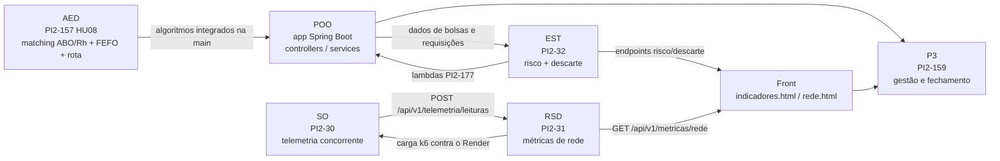

# Definition of Done da U2 e mapa de dependências

**Atividade:** PI2-180 (subtarefa da PI2-159 — Gestão da Sprint 12e13)
**Responsável:** Luis Felipe Farias Nunes
**Data:** 27/10/2026
**Vale para:** Sprints 12e13 (19/10–30/10), 14e15 (02/11–13/11) e 16e18 (16/11–04/12)

## 1. Definition of Done (DoD)

Um item do Jira só vai para **Concluído** quando cumpre todos os critérios do seu nível.

### 1.1 Subtarefa

1. Código ou documento está na `main` (merge feito, branch temporária apagada).
2. CI verde no commit do merge (GitHub Actions: build + `mvn test`).
3. Evidência registrada **em comentário no próprio ticket**: link do commit/PR e, quando houver tela ou endpoint, print ou vídeo.
4. Mensagem de commit no padrão `tipo(escopo): descrição (PI2-NNN)`.
5. Nenhum segredo versionado (senhas e chaves só em variáveis de ambiente / secrets).

### 1.2 História

1. Todas as subtarefas concluídas (máximo de 5 por história).
2. Critérios de aceite em BDD (Dado / Quando / Então) verificados — por teste automatizado quando houver código.
3. Funcionalidade acessível na aplicação implantada no Render, não só em `localhost`.
4. Documentação da disciplina atualizada em `doc/` e referenciada no README.

### 1.3 Por disciplina

| Disciplina | Critério adicional de pronto |
|---|---|
| POO | Regra de negócio em `service`, exposta em `controller` REST, com teste unitário e teste de integração do endpoint |
| AED | Algoritmo com teste unitário e análise de complexidade (tempo e espaço) documentada |
| EST | Indicador com definição operacional, fórmula, premissas e achado interpretado; nada de valor inventado quando não há base (retorna vazio ou 503) |
| SO | Execução concorrente com teste de condição de corrida; deploy feito pela esteira (PR → testes → main protegida → Render) |
| RSD | Protocolos e portas explícitos (HTTPS/443 na borda, JDBC/5432 para PostgreSQL); métricas coletadas e documentadas |
| P3 | Sprint no Jira refletindo exatamente o que foi entregue, resumo da sprint em `doc/` e burndown |

### 1.4 Incremento da U2 (definição de pronto do produto)

- Alocação por compatibilidade ABO/Rh + FEFO devolvendo a rota (HU08) em produção.
- Painel de indicadores com risco de desabastecimento e taxa de descarte.
- Telemetria de temperatura com ingestão concorrente e painel de rede.
- Build final implantado via CI/CD, documentação consolidada e roteiro da apresentação com divisão de falas.

## 2. Mapa de dependências entre disciplinas

### 2.1 Visão geral

### 2.2 Dependências críticas da Sprint 12e13

| Item que espera | Depende de | Situação em 27/10 | Risco |
|---|---|---|---|
| PI2-176 risco de desabastecimento (endpoint respondendo 503) | PI2-177 lambdas da metodologia (Luis Felipe) | entregue hoje: lambdas em `application.yml` | resolvido |
| PI2-179 cards de risco e gráfico de descarte (Mariana) | PI2-176 e PI2-178 na main | endpoints na main; painel pendente | médio — prazo até 30/10 |
| PI2-175 tela Painel de rede (Mariana) | PI2-173 Actuator + `GET /api/v1/metricas/rede` (Micaella) | PI2-173 vencida em 26/10, ainda pendente | **alto** — bloqueia PI2-175 e PI2-174 |
| PI2-174 benchmarking k6 contra o Render (Micaella) | PI2-173 métricas + app estável no Render | aguarda PI2-173; prazo 28/10 | **alto** |
| PI2-169 agregador sincronizado (Matheus) | PI2-168 endpoint de leituras com fila (Lucas) | PI2-168 em andamento | médio |
| PI2-170 simulador de veículos (Lucas) | PI2-168 | PI2-168 em andamento | médio |
| PI2-166 alocação devolve rota Dijkstra (João Pedro) | PI2-165 matriz ABO/Rh 8×8 (João Pedro) | PI2-165 pendente | médio — dependência interna de AED |
| PI2-167 doc de regras ABO/Rh e complexidade (Matheus) | PI2-165 e PI2-166 | ambas abertas | baixo — documento pode começar pelas regras |

### 2.3 Caminho crítico até o fechamento (30/10)

1. **PI2-173** (métricas de rede) → PI2-174 (benchmark) e PI2-175 (painel de rede).
2. **PI2-168** (ingestão concorrente) → PI2-169 e PI2-170.
3. **PI2-165** (matriz ABO/Rh) → PI2-166 → PI2-167 → fecha PI2-157 (HU08).

Itens fora do caminho crítico (PI2-179, documentação) podem andar em paralelo.

## 3. Regras de acompanhamento

- Conferência diária dos commits por membro; item sem commit há 2 dias úteis é sinalizado no grupo.
- Item vencido sem evidência no ticket é tratado como **não entregue** no resumo da sprint, mesmo que exista código local.
- Responsáveis mantêm seus itens até concluí-los; não há redistribuição automática de tarefas atrasadas.
- O status no Jira precisa acompanhar a `main`: se o PR foi integrado, o ticket não fica em "Em andamento".
