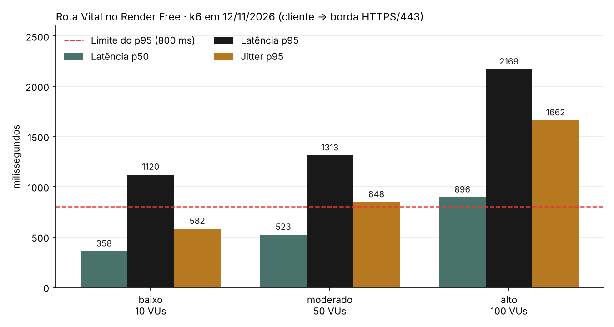

# Benchmarking de rede — Rota Vital

**Tasks:** PI2-174 — E2 · Benchmarking piloto com k6 (W12e13) · PI2-199 — N2 · Benchmarking final nos 3 cenários com perda e jitter (W14e15)
**Histórias:** PI2-31 (piloto) e PI2-37 — RSD: painel de rede com telemetria real, benchmarking final e plano de implantação
**Responsável:** Micaella Cabral
**Disciplina:** Infraestrutura de Comunicação (RSD)
**Sprints:** W12e13 (piloto) e W14e15 (final, executado em 12/11/2026)

## 1. Objetivo

Medir como a API do Rota Vital se comporta na rede real (cliente → borda HTTPS do Render → aplicação), em três níveis de carga, registrando **latência**, **vazão**, **perda**, **jitter** e **erros 4xx/5xx**, e interpretar o que os números dizem sobre o ambiente de produção. Os três cenários são os mesmos de SO ([`so-u2-arquitetura-cenarios.md`](so-u2-arquitetura-cenarios.md)), para que o dimensionamento use estes resultados.

## 2. Ferramenta e alvo

| Item | Valor |
|---|---|
| Ferramenta | [k6](https://k6.io) (Grafana Labs), script em JavaScript |
| Script | [`rsd/k6/benchmark.js`](../rsd/k6/benchmark.js) |
| Alvo do piloto | `https://rota-vital-jnmx.onrender.com` (HTTPS/443, TLS terminado no Render) |
| Caminho de rede | Cliente k6 → Internet → borda Render (HTTPS/443) → container Spring Boot (HTTP/8080) → PostgreSQL Supabase (JDBC/TCP 5432 com TLS) |
| Rotas exercitadas | 75% leitura (GET) e 25% envio de telemetria (`POST /api/v1/telemetria/leituras`, só em memória). Nada é gravado no banco de produção |

Rotas do teste:

| Rota | História |
|---|---|
| `GET /api/hospitais` | HU03 |
| `GET /api/estoques/bolsas?tipo=O_POS&componente=HEMACIAS` | HU02 (consulta FEFO) |
| `GET /api/indicadores` | HU07 |
| `GET /api/v1/indicadores/risco-desabastecimento?dias=7` | EST U2 |
| `GET /api/telemetria/temperatura?veiculoId=1` | Telemetria |
| `POST /api/v1/telemetria/leituras` (1 em cada 4 iterações) | Telemetria dos veículos (PI2-168), o canal que o painel de rede monitora |

Cada usuário virtual (VU) faz uma requisição e espera 1 s antes da próxima (tempo de "pensar" entre cliques). Nas iterações de telemetria o VU age como um veículo (`veiculoId` = 1000 + número do VU) e envia uma leitura entre 2 e 6 °C com o horário do envio.

## 3. Cenários de carga

| Cenário | VUs | Duração | Situação que representa | Quando rodar |
|---|---:|---:|---|---|
| **baixo** | 10 | 1 min | Uso normal: hemocentro e poucos hospitais | 12/11/2026, 09:56 |
| **moderado** | 50 | 2 min | Plantão: vários hospitais pedindo bolsas ao mesmo tempo | 12/11/2026, 09:57 |
| **alto** | 100 | 2 min | Pico de emergência | 12/11/2026, 10:00, com a equipe avisada (plano gratuito do Render) |

Vazão esperada pelo desenho do teste: cerca de VUs ÷ (tempo de resposta + 1 s). Para 10 VUs, um pouco menos de 10 requisições/s.

## 4. Métricas e critérios

| Métrica | De onde vem | Critério do piloto |
|---|---|---|
| Latência p50 / p95 / máx. | `http_req_duration` do k6 (tempo total da requisição, inclui rede e TLS) | p95 < 800 ms |
| Vazão | `http_reqs` do k6 (requisições/s) | Registro, sem limite |
| Taxa de erro | `http_req_failed` (status ≥ 400 ou falha de conexão) | < 1% |
| **Perda** | Métrica `perda` do script: requisição sem resposta HTTP (timeout de 10 s, conexão recusada ou resetada) | < 1% |
| **Jitter** | Métrica `jitter_ms` do script: \|latência atual − latência anterior\| do mesmo VU (variação de atraso entre pacotes consecutivos, como na RFC 3550, sem suavização) | p95 < 300 ms |
| Perda e jitter na camada de rede | `ping -n 50` para a borda do Render (ICMP) | Registro |
| Telemetria no servidor | Bloco `telemetria` de `GET /api/v1/metricas/rede` (leituras/s, atraso médio e máximo, leituras perdidas por fila cheia — PI2-198) | Registro |
| Handshake TLS | `http_req_tls_handshaking` | Registro: custo da borda HTTPS/443 |
| Tempo no servidor | `GET /api/v1/metricas/rede` (p50/p95 medidos dentro da aplicação, PI2-173) | Comparar com o k6 |

Os limites de p95, erro, perda e jitter estão no próprio script (`thresholds`): se forem violados, o k6 termina com código de saída diferente de zero.

**Leitura conjunta:** a diferença entre o p95 do k6 (cliente) e o p95 de `/api/v1/metricas/rede` (servidor) estima quanto do tempo é **rede + borda** e quanto é **processamento** na aplicação.

## 5. Como executar

1. Instalar o k6: `winget install k6` (Windows) ou ver [grafana.com/docs/k6](https://grafana.com/docs/k6/latest/set-up/install-k6/).
2. **Acordar o serviço** (plano gratuito hiberna após ~15 min): abrir `https://rota-vital-jnmx.onrender.com/actuator/health` e esperar `{"status":"UP"}`. Sem isso, o *cold start* de ~1 min entra na medição.
3. Anotar `GET https://rota-vital-jnmx.onrender.com/api/v1/metricas/rede` antes do teste e rodar `ping -n 50 rota-vital-jnmx.onrender.com`.
4. Rodar o piloto:

   ```bash
   k6 run -e BASE_URL=https://rota-vital-jnmx.onrender.com -e CENARIO=baixo rsd/k6/benchmark.js
   ```

5. Consultar `/api/v1/metricas/rede` de novo e salvar o resumo do k6 (`--summary-export`) em `doc/evidencias/rsd-u2/`.

Para outro cenário, trocar `CENARIO=moderado` ou `CENARIO=alto`. Sem `BASE_URL`, o script usa `http://localhost:8080`.

## 6. Validação do script (execução local)

Antes do piloto, o cenário baixo foi executado contra a aplicação rodando localmente (`java -jar`, perfil padrão com H2, sem rede externa), em 28/10/2026. **Estes números não medem a rede**: servem só para provar que o script funciona e como referência de tempo de processamento sem a borda.

| Métrica | k6 (cliente) | `/api/v1/metricas/rede` (servidor) |
|---|---:|---:|
| Requisições | 600 | 600 |
| Erros | 0 (0,00%) | 0 × 4xx, 0 × 5xx |
| Vazão | 9,87 req/s | 8,82 req/s (média desde o início do processo) |
| Latência p50 | 6,88 ms | ≤ 10 ms (balde) |
| Latência p95 | 19,92 ms | ≤ 25 ms (balde) |
| Latência máx. | 178,15 ms | — |

O p95 do k6 (19,92 ms) cai dentro do balde de 25 ms reportado pela aplicação, o que confirma que as duas medições são coerentes. Os dois limites do script (p95 < 800 ms e erro < 1%) passaram.

## 7. Resultados contra o Render (12/11/2026)

Execução a partir do computador da equipe (rede de banda larga comum), com k6 v1.4.2, logo depois de acordar o serviço (`/actuator/health` levou 51 s para responder: *cold start* do plano gratuito, fora da medição). Os três cenários rodaram em sequência, com 20 s de pausa entre eles. Os resumos exportados pelo k6 (`--summary-export`) dos três cenários, a saída completa do cenário baixo, o `ping` e as leituras de `/api/v1/metricas/rede` antes e depois de cada cenário estão em [`doc/evidencias/rsd-u2/`](evidencias/rsd-u2/).

| Métrica (cliente k6) | baixo (10 VUs) | moderado (50 VUs) | alto (100 VUs) |
|---|---:|---:|---:|
| Requisições | 379 | 3.657 | 5.965 |
| **Vazão** | 6,2 req/s | 30,1 req/s | 49,0 req/s |
| **Latência** p50 | 358 ms | 523 ms | 896 ms |
| Latência p95 | **1.120 ms** | **1.313 ms** | **2.169 ms** |
| Latência máx. | 9.524 ms | 3.363 ms | 10.016 ms |
| **Jitter** médio / p95 | 266 / **582 ms** | 282 / **848 ms** | 590 / **1.662 ms** |
| **Perda** (sem resposta) | 0,00% (0) | 0,00% (0) | 0,03% (2 timeouts de 10 s) |
| Erros 4xx / 5xx | 0 / 0 | 0 / 0 | 0 / 0 |
| POST de telemetria p50 / p95 | 286 / 804 ms | 397 / 796 ms | 492 / 997 ms |
| Handshake TLS (média, só nas conexões novas) | 3,8 ms | 4,4 ms | 3,8 ms |
| Limites do script | falhou (p95 e jitter) | falhou (p95 e jitter) | falhou (p95 e jitter) |

| No servidor (`/api/v1/metricas/rede`, acumulado desde a subida) | depois do baixo | depois do moderado | depois do alto |
|---|---:|---:|---:|
| Requisições atendidas | 379 | 4.036 | 9.999 |
| p50 (limite do balde) | ≤ 100 ms | ≤ 250 ms | ≤ 250 ms |
| p95 (limite do balde) | ≤ 1.000 ms | ≤ 1.000 ms | ≤ 2.500 ms |
| 4xx / 5xx | 0 / 0 | 0 / 0 | 0 / 0 |

As contagens do servidor batem com as do cliente (379; 379 + 3.657 = 4.036; 4.036 + 5.965 = 10.001, menos as 2 requisições que estouraram o timeout): nenhuma requisição se perdeu no caminho sem ser registrada.

**Camada de rede (ICMP, 50 pacotes para a borda `216.24.57.16`):** 0% de perda, RTT mínimo 70 ms, médio 77 ms, máximo 82 ms, desvio-padrão 2,4 ms e jitter médio entre pacotes consecutivos de 2,9 ms (2,3 ms pelo estimador suavizado da RFC 3550).



## 8. Interpretação

1. **A rede não é o gargalo.** Na camada de rede o caminho até a borda é estável: 77 ms de RTT, 0% de perda e cerca de 3 ms de jitter. O TLS custa menos de 5 ms em média porque o k6 reaproveita a conexão (*keep-alive*); só a primeira requisição de cada VU paga o handshake completo (até 389 ms). Mesmo no cenário baixo, a menor latência HTTP foi 258 ms, cerca de 180 ms acima do RTT: esse tempo é gasto **dentro** do Render.
2. **O gargalo é a CPU da instância gratuita (0,1 vCPU).** A vazão cresce com a carga (6 → 30 → 49 req/s), mas não na proporção dos usuários: se a resposta fosse instantânea, 100 VUs com 1 s de pausa gerariam ~100 req/s. A latência p50 sobe de 358 para 896 ms enquanto a rede continua igual. É fila de processamento: as requisições esperam a vez de usar a CPU. O p95 medido no servidor (≤ 1 s → ≤ 2,5 s) confirma que o atraso está na aplicação, não no transporte.
3. **O jitter acompanha a fila, não a rede.** Na rede ele é de ~3 ms. Na aplicação chega a 582 ms (p95) no baixo e 1,66 s no alto. Para o usuário isso significa telas que às vezes abrem rápido e às vezes demoram, com a mesma conexão. Para a telemetria, significa leituras que chegam ao servidor com atraso irregular, o que justifica guardar o horário do veículo em cada leitura (o painel de rede calcula o atraso a partir dele).
4. **Perda só apareceu no limite.** Até 50 usuários nenhuma requisição ficou sem resposta. Com 100 usuários, 2 de 5.965 (0,03%) estouraram o timeout de 10 s. Ainda abaixo do limite de 1%, mas é o primeiro sinal de saturação. Nenhum 4xx ou 5xx: a aplicação não falha sob carga, ela fica lenta.
5. **Telemetria é o tráfego mais leve.** O `POST` de leitura responde mais rápido que a média (p50 de 286 a 492 ms), porque só enfileira e devolve `202` (o processamento é assíncrono, PI2-168). A fila de 1.000 posições não encheu em nenhum cenário.
6. **Os limites do script falharam nos três cenários.** O p95 < 800 ms e o jitter p95 < 300 ms são metas para produção real. A instância gratuita não as atinge nem com 10 usuários. Por isso o dimensionamento de SO parte destes números: o cenário moderado precisa de uma instância com CPU dedicada (Standard, 1 vCPU) e o alto, de escala horizontal ([`so-u2-arquitetura-cenarios.md`](so-u2-arquitetura-cenarios.md)).

### Comparação com a validação local (seção 6)

Na máquina local, sem rede e sem limite de CPU, o mesmo cenário baixo teve p95 de 20 ms. No Render, 1.120 ms. A diferença de ~1,1 s não vem dos 77 ms de RTT: vem da CPU limitada do plano gratuito.

## 9. Fora do escopo

- **Escrita no banco:** o teste lê e envia telemetria, que fica em memória. Cenários com `POST` de requisições e doações precisam de um ambiente que não seja a produção.
- **Cold start:** ficou fora da medição (passo 2 da seção 5), mas é o maior atraso que um usuário real pode sentir no plano gratuito: 51 s na primeira requisição depois de 15 min sem uso.
- **Um só ponto de origem:** todas as medições saíram da mesma rede. Hospitais em outras cidades teriam RTT diferente até a borda; o tempo dentro do Render seria o mesmo.
