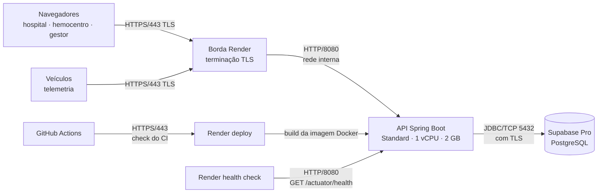

# Plano de implantação e migração — Rota Vital

**Task:** PI2-200 — N3 · Plano de implantação e migração (W14e15)
**História:** PI2-37 — RSD: painel de rede com telemetria real, benchmarking final e plano de implantação
**Responsável:** Matheus Larré
**Disciplina:** Infraestrutura de Comunicação (RSD)
**Data:** 15/11/2026
**Base:** [arquitetura em três cenários (SO, PI2-190)](so-u2-arquitetura-cenarios.md) · [benchmarking de rede (PI2-199)](rsd-benchmarking.md) · [topologia](topologia.md) · [pipeline e deploy](pipeline-deploy.md)

## 1. Objetivo

Descrever como o Rota Vital sai da produção atual, acadêmica e gratuita (**Render Free + Supabase Free**), para o **cenário moderado** dimensionado em SO (**Render Standard + Supabase Pro**). O plano cobre os ambientes, as portas e os protocolos de cada ligação, o passo a passo da migração, os critérios de aceite, os riscos e como voltar atrás.

Por que o moderado: o benchmarking de 12/11/2026 mostrou que a instância gratuita (0,1 vCPU) não atinge as metas nem com 10 usuários (p95 de 1.120 ms contra a meta de 800 ms) e hiberna, com *cold start* de 51 s. O cenário moderado (1 vCPU, banco sem pausa e com backup diário) atende um plantão com 50 usuários e 50 leituras de telemetria por segundo, a US$ 50/mês ([SO, seção 5](so-u2-arquitetura-cenarios.md#5-cenário-moderado--rede-regional-em-plantão)).

## 2. Ambientes

| Ambiente | Onde roda | Aplicação | Banco | Para que serve |
|---|---|---|---|---|
| **Dev** | Máquina do desenvolvedor | `mvn spring-boot:run` ou `docker compose up`, porta 8080 | H2 em memória (ou PostgreSQL do `docker compose`) | Desenvolvimento e demo local; dados do seed a cada subida |
| **CI** | GitHub Actions (`ubuntu-latest`) | `mvn -B verify` | H2 + PostgreSQL 16 via Testcontainers | Gate do merge: testes unitários, integração, BDD e `*IT` |
| **Produção atual** | Render Free + Supabase Free | 1 instância, 0,1 vCPU, 512 MB, hiberna após 15 min | Supabase Free, 500 MB, pausa após 7 dias sem acesso, sem backup | Avaliação acadêmica |
| **Produção alvo (moderado)** | Render Standard + Supabase Pro | 1 instância, 1 vCPU, 2 GB, sempre ligada | Supabase Pro, compute Micro, 8 GB, backup diário (7 dias) | Operação de um plantão regional |

Não há ambiente de homologação separado. Para não pagar uma segunda instância, a validação da migração usa a própria produção, em janela combinada e com o seed desligado (seção 5). Testes que gravam dados continuam só em Dev e CI.

## 3. Ligações, portas e protocolos

As ligações são as mesmas antes e depois da migração. A mudança é de capacidade, não de topologia: nenhuma porta nova é aberta.



| # | Origem | Destino | Protocolo / porta | Rede | Segurança | Finalidade |
|---|---|---|---|---|---|---|
| 1 | Navegadores (hospital, hemocentro, gestor) | Borda do Render | **HTTPS/443** (TLS 1.2+) | Internet | Certificado gerenciado pelo Render; HTTP/80 redirecionado para HTTPS | Telas e API REST |
| 2 | Veículos (telemetria) | Borda do Render | **HTTPS/443** | Internet | TLS na borda | `POST /api/v1/telemetria/leituras` |
| 3 | Borda do Render | Container da API | **HTTP/8080** | Interna do Render | Porta não exposta na internet; só a borda alcança | Encaminhar as requisições já descriptografadas |
| 4 | API | PostgreSQL (Supabase) | **JDBC sobre TCP/5432**, com TLS | Internet entre provedores (Render → Supabase) | Usuário e senha em variáveis de ambiente do Render; TLS obrigatório na conexão | Persistência de bolsas, requisições, hospitais e rotas |
| 5 | Render (health check) | Container da API | HTTP/8080, `GET /actuator/health` | Interna do Render | Actuator expõe só `health` em produção | Liberar o tráfego para uma nova versão só com `{"status":"UP"}` |
| 6 | GitHub | Render | **HTTPS/443** (webhook) | Internet | Integração do GitHub com o Render; segredos fora do repositório | Deploy depois do check `build-and-test` verde |
| 7 | Equipe | Supabase (painel e `pg_dump`) | HTTPS/443 (painel) e TCP/5432 com TLS (`pg_dump`/`psql`) | Internet | Conta da equipe e senha do banco, nunca versionadas | Backup, restauração e conferência dos dados |

Nota sobre o trecho 4: o Render e o Supabase são provedores diferentes, então a conexão com o banco passa pela internet e não por uma rede privada. Por isso o TLS na conexão JDBC é obrigatório e a senha do banco só existe nas variáveis de ambiente do Render. O Supabase Pro permite restringir as conexões por endereço de origem (*network restrictions*); fica como melhoria quando o Render tiver IPs de saída fixos para o serviço.

## 4. O que muda na migração

| Item | Hoje (Free) | Depois (moderado) | Muda no código? |
|---|---|---|---|
| Instância do Render | Free, 0,1 vCPU, 512 MB, hiberna | Standard, 1 vCPU, 2 GB, sempre ligada | Não: troca de *instance type* no painel |
| Memória da JVM | Padrão da JVM (25% da memória do container) | `JAVA_TOOL_OPTIONS=-XX:MaxRAMPercentage=75` (cerca de 1,5 GB de *heap*) | Não: variável de ambiente no Render |
| Plano do Supabase | Free, 500 MB, pausa, sem backup | Pro, compute Micro, 8 GB, backup diário | Não: upgrade da organização no painel; o projeto, a URL e os dados continuam os mesmos |
| `SPRING_DATASOURCE_*` | Host do projeto atual | Os mesmos valores | Não |
| Carga de dados sintéticos | `HEMOREDE_SEED_ENABLED` ligado | `HEMOREDE_SEED_ENABLED=false` antes da operação real | Não: variável de ambiente |
| Esquema do banco | `ddl-auto: update` (Hibernate) | Igual | Não |
| Pipeline | PR → CI verde → Render "After CI Checks Pass" → health check | Igual | Não |

O upgrade do Supabase é feito no mesmo projeto, sem copiar dados para um banco novo. Isso evita a parte mais arriscada de uma migração (exportar, importar e trocar a URL de conexão). Mesmo assim, um `pg_dump` é feito antes, como ponto de restauração.

## 5. Passo a passo

**Janela:** fora do horário de aula, avisando a equipe com um dia de antecedência. Duração estimada: 1 hora, com até cerca de 5 minutos sem serviço (reinício do banco e troca de instância).

### Antes (D-1)

1. Conferir que o último commit da `main` tem CI verde e está **Live** no Render.
2. Medir a linha de base, para comparar depois: `ping -n 50 rota-vital-jnmx.onrender.com`, `GET /api/v1/metricas/rede` e o k6 do cenário baixo ([`rsd-benchmarking.md`, seção 5](rsd-benchmarking.md#5-como-executar)).
3. Anotar o deploy atual no Render (aba **Events**): é o alvo do rollback da aplicação.
4. Fazer o backup completo do banco, usando a string de conexão do Supabase (porta 5432, `sslmode=require`):

   ```bash
   pg_dump "postgresql://<usuario>@<host-supabase>:5432/postgres?sslmode=require" \
     --format=custom --no-owner --file=rotavital-antes-migracao.dump
   ```

   Guardar o arquivo fora do repositório (contém dados do banco).
5. Contar os registros principais para conferir depois (bolsas, requisições, hospitais), com `psql` ou no editor SQL do Supabase.

### Durante (dia D)

| # | Ação | Onde | Conferência |
|---|---|---|---|
| 1 | Upgrade da organização para **Pro** e compute **Micro** | Supabase → Billing / Compute | Projeto com status **Healthy**; o banco reinicia e fica alguns minutos indisponível |
| 2 | Conferir a conexão do banco | Editor SQL do Supabase | As contagens batem com as do passo 5 de D-1 |
| 3 | Trocar o *instance type* para **Standard** | Render → serviço → Settings → Instance Type | O Render faz um novo deploy da mesma versão |
| 4 | Adicionar `JAVA_TOOL_OPTIONS=-XX:MaxRAMPercentage=75` | Render → Environment | Novo deploy; o log da JVM mostra a opção aplicada |
| 5 | Esperar o deploy ficar **Live** | Render → Events | `GET /actuator/health` → `{"status":"UP"}` |
| 6 | Teste de fumaça das telas | Navegador | Login, estoque, lista de requisições e painel de rede abrem sem erro |

### Depois (validação)

1. Rodar o k6 do cenário moderado contra a produção:

   ```bash
   k6 run -e BASE_URL=https://rota-vital-jnmx.onrender.com -e CENARIO=moderado \
     --summary-export=doc/evidencias/rsd-u2/resumo-moderado-standard.json rsd/k6/benchmark.js
   ```

2. Ler `GET /api/v1/metricas/rede` antes e depois do k6.
3. Deixar o serviço 20 minutos sem uso e fazer uma requisição: com a instância Standard, não pode haver *cold start*.
4. Registrar os resultados ao lado dos da seção 7 do benchmarking.

### Critérios de aceite

| Critério | Meta | Medido hoje no Free (moderado) |
|---|---|---|
| Latência p95 (k6) | < 800 ms | 1.313 ms |
| Jitter p95 (k6) | < 300 ms | 848 ms |
| Perda (sem resposta) | < 1% | 0% |
| Erros 5xx | 0 | 0 |
| Leituras de telemetria perdidas (`/api/v1/metricas/rede`) | 0 | 0 |
| Primeira requisição após 20 min sem uso | < 2 s | 51 s |
| Contagem de registros no banco | igual à de D-1 | — |

Os quatro primeiros são os `thresholds` do próprio script do k6: se ele terminar com código de saída 0, passaram. Se algum critério falhar, a migração não é desfeita automaticamente: primeiro se avalia o motivo (seção 6). O rollback (seção 7) só é feito se o serviço ficar pior do que antes ou indisponível.

## 6. Riscos

| # | Risco | Probabilidade | Impacto | Mitigação |
|---|---|---|---|---|
| 1 | Indisponibilidade durante o reinício do banco ou a troca de instância | Alta | Baixo (minutos) | Janela fora do horário de uso, aviso à equipe, health check do Render só libera tráfego para a nova versão quando ela responde `UP` |
| 2 | Perda ou corrupção de dados no upgrade do Supabase | Baixa | Alto | `pg_dump` antes da migração, contagem de registros antes e depois, restauração com `pg_restore` se as contagens divergirem |
| 3 | Seed recriando dados sintéticos sobre dados reais | Média | Médio | `HEMOREDE_SEED_ENABLED=false` antes de qualquer dado real entrar |
| 4 | JVM sem memória (container reiniciado) sob carga | Baixa | Médio | `MaxRAMPercentage=75` e acompanhamento da memória no painel do Render durante o k6 |
| 5 | p95 continuar acima de 800 ms mesmo com 1 vCPU | Média | Médio | A estimativa de SO dá ~20% de CPU no moderado. Se a meta falhar, verificar se o gargalo passou para o banco (CPU do Supabase) ou para a rede (RTT do `ping`). A rota seguinte é o cenário alto, não um rollback |
| 6 | Esgotamento de conexões com o banco | Baixa | Médio | Uma instância com o pool padrão do Spring (Hikari, 10 conexões) fica bem abaixo do limite do compute Micro |
| 7 | Custo maior que o previsto (tráfego excedente) | Baixa | Baixo | No moderado o tráfego estimado cabe na franquia do Render; alerta de gasto configurado no Render e no Supabase |
| 8 | Vazamento da senha do banco durante a migração | Baixa | Alto | Senha só nas variáveis do Render e no gerenciador da equipe; o arquivo do `pg_dump` não vai para o Git; se vazar, trocar a senha no Supabase e atualizar a variável no Render |
| 9 | Commit com problema publicado logo depois da migração | Média | Médio | Pipeline continua igual: CI verde obrigatório e health check; rollback do deploy pelo Render ([`pipeline-deploy.md`, seção 5](pipeline-deploy.md#5-como-reverter-um-deploy)) |

## 7. Plano de rollback

Cada parte da migração volta atrás de forma independente. A ordem é da mais rápida para a mais lenta.

| Gatilho | Ação | Tempo estimado |
|---|---|---|
| Nova versão não fica **Live** ou o health check falha | Nada a fazer: o Render mantém a versão anterior no ar. Corrigir a causa (variável de ambiente, memória) e repetir o passo | Imediato |
| Aplicação no ar, mas com erros 5xx ou lenta depois da troca de instância | Render → Events → **Rollback** para o deploy anotado em D-1. Remover `JAVA_TOOL_OPTIONS` se o problema for de memória. Reativar o Auto-Deploy depois | 1 a 3 min |
| Instância Standard sem ganho e custo não justificado | Voltar o *instance type* para Free no Render. Os dados não são afetados | 2 a 5 min |
| Dados divergentes depois do upgrade do Supabase | Colocar a aplicação em manutenção (suspender o serviço no Render), restaurar o backup e conferir as contagens antes de religar | 15 a 30 min |
| Voltar o banco para o plano gratuito | Downgrade da organização para Free no Supabase. Só é possível se o banco couber nos 500 MB; o backup diário deixa de existir | Minutos, com reinício do banco |

Restauração do backup de D-1:

```bash
pg_restore --clean --if-exists --no-owner \
  --dbname="postgresql://<usuario>@<host-supabase>:5432/postgres?sslmode=require" \
  rotavital-antes-migracao.dump
```

Atenção: restaurar o backup de D-1 descarta o que foi gravado depois dele. Antes de restaurar, fazer um novo `pg_dump` do estado atual, para não perder dados que estejam corretos.

Depois de qualquer rollback: conferir `GET /actuator/health`, abrir as telas principais, registrar o que aconteceu no Jira e repetir a migração só depois de entender a causa.

## 8. Depois do moderado

O cenário alto ([SO, seção 6](so-u2-arquitetura-cenarios.md#6-cenário-alto--pico-de-emergência)) não é só uma troca de plano: exige separar a telemetria em um serviço próprio de uma instância e ligar o autoscaling da API, o que depende de mudança no código (perfil de configuração e novo endereço para os veículos). Ele só entra quando o painel de rede mostrar a CPU da instância Standard acima de 70% de forma sustentada ou o p95 voltar a passar de 800 ms com a carga real.

## Fontes

- [`doc/so-u2-arquitetura-cenarios.md`](so-u2-arquitetura-cenarios.md) — cenários, custos e justificativas (PI2-190)
- [`doc/rsd-benchmarking.md`](rsd-benchmarking.md) — números do benchmarking contra o Render (PI2-199)
- [`doc/pipeline-deploy.md`](pipeline-deploy.md) — pipeline, variáveis de ambiente e rollback de deploy
- [`doc/topologia.md`](topologia.md) — ligações e protocolos da topologia final
- [Render — Scaling](https://render.com/docs/scaling) e [Render — Pricing](https://render.com/pricing)
- [Supabase — Pricing](https://supabase.com/pricing) e [Supabase — Backups](https://supabase.com/docs/guides/platform/backups)
