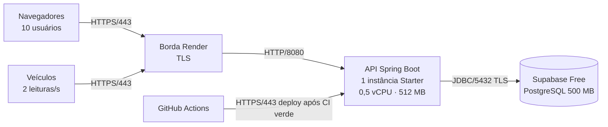
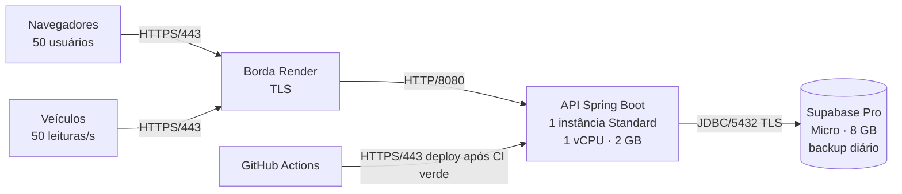
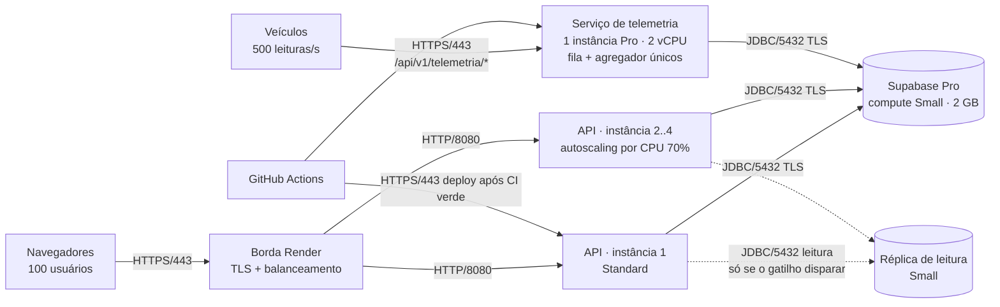

# SO U2 — Arquitetura em três cenários de uso, com orçamento

**Disciplina:** Infraestrutura de Software (SO)
**Atividade:** PI2-190 — J2 · Arquitetura em 3 cenários (baixo/moderado/alto) com orçamento (história PI2-222)
**Responsável:** Luis Felipe Farias Nunes
**Data:** 12/11/2026
**Relacionados:** [benchmarking de rede (RSD, PI2-199)](rsd-benchmarking.md) · [agregador sincronizado da telemetria](so-u2-sincronizacao.md) · [pipeline e deploy](pipeline-deploy.md) · [topologia](topologia.md)

> Preços em dólar, consultados em 12/11/2026 nas páginas oficiais do [Render](https://render.com/pricing) e do [Supabase](https://supabase.com/pricing). Conversão por R$ 5,51 (dólar comercial de 09/11/2026). Valores mensais, sem impostos sobre serviço importado.

## 1. Objetivo

Dimensionar a infraestrutura do Rota Vital para três níveis de uso, justificar cada escolha com números medidos no próprio projeto e estimar o custo mensal de cada cenário. A regra é a do professor: orçamento realista e sem *over-engineering*. Cada cenário só ganha um componente novo quando a medição mostra que o anterior não aguenta.

## 2. O que a arquitetura precisa atender

| Cenário | Situação | Usuários simultâneos | Veículos enviando telemetria | Carga estimada na API |
|---|---|---:|---|---:|
| **Baixo** | Uso normal: um hemocentro e poucos hospitais | 10 | 10 veículos, 1 leitura a cada 5 s (2 leituras/s) | ~12 req/s |
| **Moderado** | Plantão: vários hospitais pedindo bolsas ao mesmo tempo | 50 | 50 veículos, 1 leitura/s cada (50 leituras/s) | ~100 req/s |
| **Alto** | Pico de emergência na rede | 100 | 100 veículos, 1 leitura a cada 200 ms (500 leituras/s) | ~600 req/s |

Os números de usuários são os mesmos do k6 de RSD ([`rsd/k6/benchmark.js`](../rsd/k6/benchmark.js)) e os de veículos são os do simulador de telemetria (`hemorede.simulador.cenarios` em [`application.yml`](../rotavital/src/main/resources/application.yml)). A carga na API soma ~1 requisição por segundo por usuário (cada clique espera ~1 s) mais as leituras de telemetria.

Ligações que existem em todos os cenários (mesmas da [topologia](topologia.md)):

| Trecho | Protocolo / porta |
|---|---|
| Navegador e veículos → borda do Render | HTTPS/443 (TLS terminado na borda) |
| Borda → container da API Spring Boot | HTTP/8080 (rede interna do Render) |
| API → PostgreSQL no Supabase | JDBC sobre TCP/5432, com TLS |
| GitHub Actions → Render (deploy) | HTTPS/443, só depois do CI verde |

## 3. Ponto de partida: o que a medição mostrou

Benchmarking de 12/11/2026 contra a produção atual (Render Free + Supabase Free), detalhado em [`rsd-benchmarking.md`](rsd-benchmarking.md):

| | baixo (10 VUs) | moderado (50 VUs) | alto (100 VUs) |
|---|---:|---:|---:|
| Vazão alcançada | 6,2 req/s | 30,1 req/s | 49,0 req/s |
| Latência p50 / p95 | 358 / 1.120 ms | 523 / 1.313 ms | 896 / 2.169 ms |
| Perda / 5xx | 0% / 0 | 0% / 0 | 0,03% / 0 |

Três conclusões guiam o dimensionamento:

1. **O limite é CPU, não rede.** A rede até a borda tem 77 ms de RTT e 0% de perda; o resto da latência é fila dentro do container. A instância gratuita tem **0,1 vCPU**: com 100 VUs ela fica em ~49 req/s e as requisições esperam a vez (escalonamento da CPU). Isso dá um custo aproximado de **2 ms de CPU por requisição** (0,1 CPU-segundo ÷ 49 req). É com esse número que se estima quanta CPU cada cenário precisa.
2. **O banco não pesou.** Mesmo no alto, o `/api/v1/metricas/rede` não registrou 5xx e o gargalo continuou na CPU da aplicação. O Supabase gratuito aguentou a carga de leitura dos testes.
3. **O plano gratuito hiberna.** Depois de 15 min sem uso, a primeira requisição levou **51 s** (*cold start* medido hoje). Para uma rede de sangue, onde um pedido urgente pode chegar de madrugada, isso não é aceitável fora do ambiente acadêmico.

### Restrição de SO: a telemetria tem estado em memória

O `AgregadorTelemetria` guarda contadores, médias e alertas por veículo em memória, protegidos por `ConcurrentHashMap`, `LongAdder` e CAS ([`so-u2-sincronizacao.md`](so-u2-sincronizacao.md)). A fila de ingestão (`LinkedBlockingQueue` de 1.000 posições) e os consumidores também vivem dentro do processo. A sincronização garante que **dentro de uma instância** nenhuma leitura se perde. Mas se duas instâncias recebessem leituras do mesmo veículo, cada uma teria só parte dos dados. Por isso:

- nos cenários baixo e moderado há **uma** instância da aplicação (escala vertical);
- no alto, a API escala na horizontal, mas a telemetria fica isolada num serviço de **uma** instância, para continuar com um único agregador.

## 4. Cenário baixo — piloto com um hemocentro

| Item | Plano | US$/mês |
|---|---|---:|
| Workspace Render | Hobby | 0,00 |
| Web service (API + telemetria) | Starter — 0,5 vCPU, 512 MB, sempre ligado | 7,00 |
| Banco PostgreSQL | Supabase Free — 500 MB, sem backup automático | 0,00 |
| **Total** | | **7,00 (≈ R$ 38,57)** |

**Justificativa.** A carga de ~12 req/s × 2 ms de CPU usa ~24 ms de CPU por segundo, ou seja, ~5% de 0,5 vCPU. A instância Starter tem 5 vezes a CPU da gratuita e **não hiberna**, o que elimina o *cold start* de 51 s. O banco de 500 MB é suficiente: a base atual tem dezenas de bolsas e requisições.

**Variante atual (acadêmica, US$ 0):** Render Free + Supabase Free. É o que está em produção hoje e serve para avaliação, mas o benchmarking mostrou p95 de 1,1 s já com 10 usuários e o serviço hiberna. Não serve para operação real.

**Riscos aceitos:** sem backup automático no Supabase Free (mitigação: `pg_dump` semanal pela equipe) e o projeto gratuito pausa após 7 dias sem acesso.

## 5. Cenário moderado — rede regional em plantão

| Item | Plano | US$/mês |
|---|---|---:|
| Workspace Render | Hobby | 0,00 |
| Web service (API + telemetria) | Standard — 1 vCPU, 2 GB | 25,00 |
| Banco PostgreSQL | Supabase Pro (US$ 25) com compute Micro (US$ 10, coberto pelo crédito de US$ 10 do plano) | 25,00 |
| **Total** | | **50,00 (≈ R$ 275,50)** |

**Justificativa.**

- **CPU:** ~100 req/s × 2 ms = 0,2 CPU-segundo por segundo, ou ~20% de 1 vCPU. Sobra margem para picos e para o coletor de lixo da JVM. Com 0,5 vCPU (Starter) a ocupação seria ~40% em média, mas os picos de plantão encostariam no limite e a fila voltaria a aparecer, como no teste.
- **Memória:** 2 GB permitem dar à JVM um *heap* folgado. Com 512 MB, a JVM do Spring Boot fica perto do limite e o container pode ser reiniciado por falta de memória sob carga.
- **Uma instância só:** a telemetria (50 leituras/s) continua no mesmo processo, com um agregador e uma fila. A sincronização já testada vale sem mudança.
- **Banco:** o Supabase Pro não pausa, faz backup diário (7 dias) e tem 8 GB de disco. Num plantão real, perder o registro de uma bolsa reservada não é aceitável.

## 6. Cenário alto — pico de emergência

| Item | Plano | US$/mês |
|---|---|---:|
| Workspace Render | Pro — necessário para autoscaling horizontal | 25,00 |
| API (web service) | Standard, autoscaling de 2 a 4 instâncias | 50,00 a 100,00 |
| Telemetria (web service, mesma imagem) | Pro — 2 vCPU, 4 GB, 1 instância fixa | 85,00 |
| Banco PostgreSQL | Supabase Pro (US$ 25) + compute Small (US$ 15) − crédito (US$ 10) | 30,00 |
| Tráfego de saída acima da franquia | ~150 GB/mês estimados − 25 GB inclusos = 125 GB × US$ 0,15 | 18,75 |
| **Total base (2 instâncias de API)** | | **208,75 (≈ R$ 1.150,21)** |
| Réplica de leitura (só com gatilho) | Supabase Small (US$ 15) + disco extra (~US$ 1,25) | +16,25 |
| **Total no pico (4 instâncias + réplica)** | | **275,00 (≈ R$ 1.515,25)** |

**Justificativa.**

- **CPU:** ~600 req/s × 2 ms = 1,2 CPU-segundo por segundo. Uma instância de 1 vCPU não dá conta. Separando: as ~100 req/s dos usuários pedem ~0,2 vCPU, e as 500 leituras/s pedem ~1 vCPU sozinhas. Por isso a telemetria vai para uma instância Pro de 2 vCPU (~50% de ocupação), e não para uma Standard, que ficaria no limite.
- **API em escala horizontal:** sem a telemetria, a API não guarda estado em memória (o estado de bolsas e requisições está no PostgreSQL), então pode ter várias instâncias atrás do balanceador da borda. O mínimo de 2 dá redundância: se uma instância cair num deploy ou por falha, a outra atende. O autoscaling sobe até 4 quando a CPU passa de 70%.
- **Telemetria em serviço próprio, com 1 instância:** mantém uma fila e um agregador, como exige a sincronização em memória. Os veículos passam a enviar para o endereço desse serviço. É a mesma imagem Docker: muda só a configuração de qual parte da aplicação atende.
- **Banco:** o compute Small dobra a memória (2 GB) e aumenta o limite de conexões (90 diretas e 400 pelo pooler), necessário com 3 a 5 instâncias abrindo conexões ao mesmo tempo.
- **Réplica de leitura só com gatilho:** o teste não mostrou o banco como gargalo. A réplica entra apenas se a CPU do banco passar de 70% por mais de 15 min nos painéis do Supabase. As rotas que mais leem (indicadores, estoque, risco) iriam para ela.
- **Tráfego:** a resposta média medida no k6 foi de 577 bytes. 600 req/s × 577 B ≈ 350 KB/s; com 4 h de pico por dia, ≈ 150 GB/mês.

**O que o cenário alto exige no código (ainda não feito):** um perfil de configuração que liga só a ingestão de telemetria no serviço dedicado e a desliga nas instâncias da API, e o endereço do serviço de telemetria nos veículos e no painel de rede. Se no futuro a telemetria também precisar de mais de uma instância, o agregador em memória tem de ir para um armazenamento compartilhado (por exemplo, uma tabela de leituras no PostgreSQL ou um Redis), e a sincronização passa a ser feita pelo banco.

## 7. Comparação dos cenários

| | Baixo | Moderado | Alto |
|---|---|---|---|
| Usuários / leituras por segundo | 10 / 2 | 50 / 50 | 100 / 500 |
| Instâncias da aplicação | 1 Starter | 1 Standard | 2–4 Standard (API) + 1 Pro (telemetria) |
| vCPU total | 0,5 | 1 | 4 a 6 |
| Ocupação de CPU estimada | ~5% | ~20% | API ~10%, telemetria ~50% |
| Banco | Supabase Free | Supabase Pro, Micro | Supabase Pro, Small (+ réplica com gatilho) |
| Backup | manual (`pg_dump`) | diário, 7 dias | diário, 7 dias |
| Hibernação / cold start | não | não | não |
| Redundância da API | não | não | sim (mínimo 2 instâncias) |
| Escala | manual | vertical | horizontal com autoscaling |
| **Custo mensal** | **US$ 7 (≈ R$ 39)** | **US$ 50 (≈ R$ 276)** | **US$ 209 a 275 (≈ R$ 1.150 a 1.515)** |

Leitura: do baixo para o moderado o custo sobe 7 vezes para atender 8 vezes mais carga; do moderado para o alto sobe 4 a 5,5 vezes para 6 vezes mais carga, e ganha redundância na API. O custo por req/s de capacidade cai com a escala: US$ 0,58 no baixo (7 ÷ 12), US$ 0,50 no moderado (50 ÷ 100) e US$ 0,35 a 0,46 no alto (209 a 275 ÷ 600).

## 8. O que ficou de fora de propósito (evitar *over-engineering*)

| Componente | Por que não entrou |
|---|---|
| Kubernetes ou VMs próprias | O Render já faz deploy, balanceamento, TLS e autoscaling. Operar um cluster exigiria uma pessoa só para isso |
| Cache Redis para leituras | O teste não mostrou o banco como gargalo. Só entra se a réplica não bastar |
| Fila gerenciada (Kafka, SQS) para telemetria | 500 leituras/s cabem numa `LinkedBlockingQueue` de um processo. Uma fila externa faz sentido acima de alguns milhares por segundo ou com várias instâncias de telemetria |
| Várias regiões | Os usuários são de uma mesma rede estadual. Uma região atende com 77 ms de RTT |

## 9. Como validar cada cenário

1. Subir o plano do cenário no Render e no Supabase.
2. Ligar o simulador com o mesmo cenário: `--hemorede.simulador.enabled=true --hemorede.simulador.cenario=moderado`.
3. Rodar o k6 do mesmo cenário: `k6 run -e BASE_URL=<url> -e CENARIO=moderado rsd/k6/benchmark.js`.
4. Critério de aceite: os limites do script passam (p95 < 800 ms, jitter p95 < 300 ms, perda < 1%) e o painel de rede mostra zero leituras perdidas na telemetria.
5. Conferir a contagem final do agregador, como na demonstração concorrente (J4, PI2-192): leituras enviadas = leituras processadas.

## Fontes

- [Render — Pricing](https://render.com/pricing) (instâncias Free, Starter US$ 7, Standard US$ 25, Pro US$ 85; workspace Pro US$ 25; tráfego excedente US$ 0,15/GB)
- [Render — Scaling](https://render.com/docs/scaling) (autoscaling exige workspace Pro)
- [Supabase — Pricing](https://supabase.com/pricing) (Pro US$ 25 com US$ 10 de crédito de compute; Micro US$ 10, Small US$ 15)
- [Supabase — Read Replicas](https://supabase.com/docs/guides/platform/read-replicas) (réplica exige compute Small ou maior)
