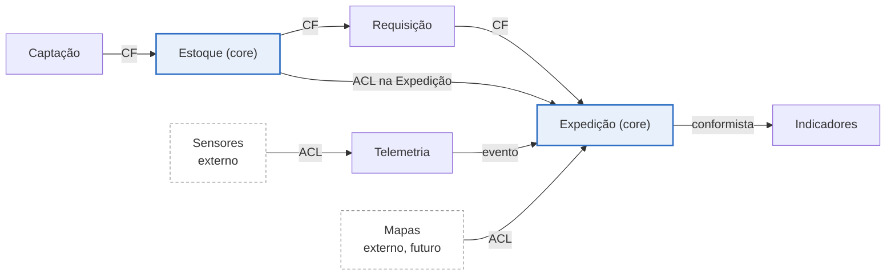

# Seção A — Remodelagem do domínio com DDD

A remodelagem reorganiza o que o código da `main` já tem (9 entidades JPA, 16 services e 12 controllers), sem inventar funcionalidade.

## A.1 Subdomínios

| Subdomínio | Tipo | Justificativa |
|---|---|---|
| Estoque e alocação de hemocomponentes | **Core** | É o diferencial: liberar a bolsa compatível (ABO/Rh) que vence primeiro (FEFO), nunca uma vencida, para reduzir descarte e falta. |
| Distribuição com cadeia fria | **Core** | A rota de menor custo com veículo de refrigeração compatível é a outra metade da proposta de valor e não existe pronta para essa rede. |
| Requisição hospitalar | Suporte | Workflow de pedido comum (prioridade, aprovação); a regra difícil fica na alocação. |
| Captação de doações | Suporte | Registra doador e coleta e aplica o intervalo mínimo entre doações; alimenta o estoque, mas não diferencia o produto. |
| Monitoramento de temperatura | Suporte | Classifica leituras em OK ou ALERTA; hoje simulado, pode ser trocado por sensores reais sem mexer no core. |
| Indicadores e previsão | Suporte | Taxa de descarte, risco de desabastecimento e demanda; só leem dados dos outros subdomínios. |
| Identidade e acesso | Genérico | Login e perfis são problema resolvido: usar Spring Security ou um provedor de identidade. |
| Mapas e geolocalização | Genérico | Distâncias reais viriam de um serviço de mapas; hoje o grafo de rotas é sintético. |

## A.2 Bounded contexts

| Contexto | Responsabilidade |
|---|---|
| Captação | Registrar doadores e doações e gerar a bolsa coletada, respeitando o intervalo mínimo entre doações. |
| **Estoque** (core) | Guardar as bolsas, controlar validade e status e reservar bolsas compatíveis por FEFO. |
| Requisição | Receber o pedido do hospital, priorizar, pedir a reserva ao Estoque e aprovar só quando todos os itens estiverem atendidos. |
| **Expedição** (core) | Planejar a rota, escolher veículo e motorista compatíveis com a cadeia fria e confirmar a entrega. |
| Telemetria | Receber leituras de temperatura dos veículos e sinalizar quando saem da faixa segura. |
| Indicadores | Calcular os painéis de gestão a partir dos dados dos outros contextos, só com leitura. |

O Hospital não vira contexto próprio: cada contexto guarda só o que precisa dele. Um **kernel compartilhado** pequeno (`TipoSanguineo`, `HemoComponente`, `TipoRefrigeracao`) é usado por quatro contextos, e qualquer mudança nele exige acordo do squad.

## A.3 Glossário da linguagem ubíqua

Termos com **sentido diferente por contexto**: Bolsa (Estoque, Expedição e Captação), Hospital (Requisição e Expedição) e Alerta (Telemetria e Estoque).

| Termo | Contexto | Significado |
|---|---|---|
| Bolsa | Estoque | Unidade de hemocomponente armazenada, com tipo, componente, validade e status (disponível, reservada, em trânsito, utilizada, descartada). É o que se reserva e se descarta. |
| Bolsa (Carga) | Expedição | Volume a transportar: importam a identificação, a refrigeração exigida e o espaço no veículo; validade e compatibilidade não importam. |
| Bolsa coletada | Captação | Resultado de uma doação, ligada ao doador e à data da coleta; vira Bolsa do Estoque ao ser registrada. |
| Hospital solicitante | Requisição | Quem faz o pedido; importa a identificação. |
| Destino | Expedição | O mesmo hospital visto como nó do grafo de rotas (`codigoNo`) e coordenadas. |
| Hemocomponente e tipo sanguíneo | Kernel | Hemácias, plasma, plaquetas ou crioprecipitado (define validade e refrigeração) e grupo ABO mais fator Rh. |
| Compatibilidade | Estoque | Regra de quais tipos de doador servem a um receptor (O− serve a todos). |
| FEFO | Estoque | *First Expired, First Out*: entre as bolsas compatíveis, sai a de validade mais próxima. |
| Reserva | Estoque | Vincular bolsas disponíveis a um item de requisição, mudando o status para reservada (no código atual, alocação). |
| Requisição | Requisição | Pedido de um hospital com itens, prioridade e status (pendente, aprovada, em rota, entregue, cancelada). |
| Rota | Expedição | Viagem planejada com veículo, motorista, requisições atendidas e horários. |
| Leitura | Telemetria | Temperatura medida em um veículo num instante. |
| Alerta | Telemetria | Leitura fora da faixa segura (`AlertaTemperatura`). |
| Alerta | Estoque | Estoque abaixo do mínimo ou bolsa perto de vencer (`AlertaEstoque`). |
| Taxa de descarte | Indicadores | Bolsas descartadas sobre o total do período. |

## A.4 Mapa de contextos

Seta: de quem fornece para quem consome. CF = cliente-fornecedor, ACL = camada anticorrupção, conformista = aceita o modelo como vem.

| Relação | Tipo | Como funciona |
|---|---|---|
| Captação → Estoque | Cliente-fornecedor | O Estoque define o que precisa (tipo, componente, data da coleta); a Captação entrega pelo evento `BolsaColetada`. |
| Estoque → Requisição | Cliente-fornecedor | A Requisição pede a reserva pelo caso de uso público `ReservarBolsas`; FEFO e compatibilidade ficam só no Estoque. |
| Requisição → Expedição | Cliente-fornecedor | A Expedição consome `RequisicaoAprovada` e monta a fila de roteirização, urgentes primeiro. |
| Estoque → Expedição | Camada anticorrupção | A Expedição traduz a Bolsa em Carga (identificação, refrigeração, volume), para que mudanças no Estoque não quebrem a roteirização. |
| Telemetria → Expedição | Cliente-fornecedor, por evento | `TemperaturaForaDaFaixa`; a Expedição decide o que fazer com a rota em andamento. |
| Sensores → Telemetria; Mapas → Expedição | Camada anticorrupção | Traduzem o formato do dispositivo (simulador hoje, MQTT depois) e o do serviço de mapas (futuro) para `Leitura` e `GrafoRotas`. |
| Estoque, Requisição, Expedição → Indicadores | Conformista | Indicadores só leem e aceitam o modelo dos outros como vem. |
| Identidade → todos | Conformista | Todos aceitam o modelo de usuário e perfil da solução pronta. |
