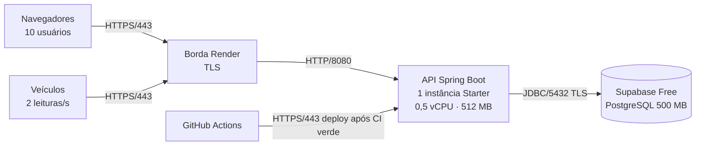
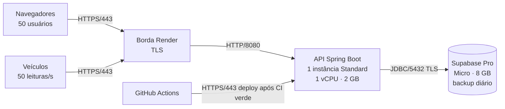
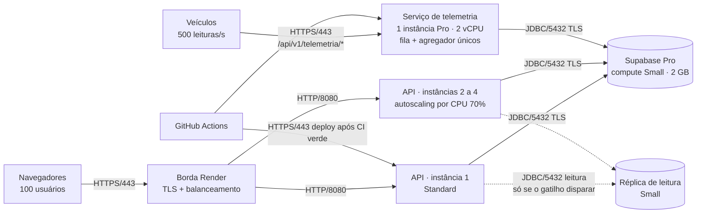

# Seção E — Três cenários, Lei de Little e orçamento

Orçamento realista e sem *over-engineering*: cada cenário só ganha um componente novo quando a medição mostra que o anterior não aguenta. Planilha completa e editável: [`orcamento-cenarios.xlsx`](orcamento-cenarios.xlsx).

## E.1 Premissas de carga

| | Baixo | Moderado | Alto |
|---|---|---|---|
| Situação | Piloto: um hemocentro e poucos hospitais | Plantão: vários hospitais pedindo ao mesmo tempo | Pico de emergência na rede |
| Usuários simultâneos | 10 | 50 | 100 |
| Pedidos de bolsa por dia | 20 | 200 | 1.000 |
| Veículos e leituras de telemetria | 10 veículos, 2 leituras/s | 50 veículos, 50 leituras/s | 100 veículos, 500 leituras/s |
| Pico de requisições por segundo (λ) | ~12 | ~100 | ~600 |
| Disponibilidade desejada | 99,0% (até ~7 h fora por mês) | 99,5% (~3,6 h) | 99,9% (~43 min) |

Usuários e veículos são os do k6 (`rsd/k6/benchmark.js`) e do simulador de telemetria: ~1 requisição por segundo por usuário mais as leituras. Pedidos por dia: 2, 4 e 10 por usuário; no mês, 440 e 4.400 (22 dias úteis) e 30.000 (todos os dias). Em 99,9% não cabe uma instância única de API, por isso o alto tem no mínimo duas.

## E.2 Ponto de partida medido

Benchmarking de 12/11/2026 na produção atual (Render gratuito, 0,1 vCPU, e Supabase gratuito):

| | Baixo (10 VUs) | Moderado (50 VUs) | Alto (100 VUs) |
|---|---:|---:|---:|
| Vazão (λ) | 6,2 req/s | 30,1 req/s | 49,0 req/s |
| Latência p50 / p95 | 358 / 1.120 ms | 523 / 1.313 ms | 896 / 2.169 ms |
| Perda / erros 5xx | 0% / 0 | 0% / 0 | 0,03% / 0 |

O limite é a **CPU** (0,1 vCPU satura em ~49 req/s, ou ~2 ms de CPU por requisição), não a rede nem o banco. **Conferência com a Lei de Little:** no teste fechado, N = λ × (W + Z), com Z = 1 s de espera, então W = N ÷ λ − Z dá 0,61 s, 0,66 s e 1,04 s, sempre entre o p50 e o p95, como esperado.

## E.3 Lei de Little no pico

L = λ × W: requisições em andamento = taxa de chegada × tempo no sistema. Meta de **W = 0,30 s** (o p95 do k6 deve ficar abaixo de 800 ms); hoje W = 1,04 s por causa da fila de CPU. CPU ocupada = λ × S, com S = 2 ms.

| Cenário | Serviço | λ | W alvo | L = λ·W | CPU = λ·S | Instâncias | Ocupação |
|---|---|---:|---:|---:|---:|---|---:|
| Baixo | API + telemetria | 12 | 0,30 s | 3,6 | 0,024 vCPU | 1 × 0,5 vCPU | ~5% |
| Moderado | API + telemetria | 100 | 0,30 s | 30 | 0,20 vCPU | 1 × 1 vCPU | ~20% |
| **Alto** | API (usuários) | 100 | 0,30 s | 30 (15 por instância) | 0,20 vCPU | **2 a 4** × 1 vCPU | ~10% cada |
| **Alto** | Telemetria | 500 | 0,02 s | 10 | 1,0 vCPU | **1** × 2 vCPU | ~50% |
| **Alto** | Fila de ingestão | 500 | 0,001 s | 0,5 na fila | n/a | dentro da telemetria | fila de 1.000 |

A telemetria sai da API porque 500 leituras/s pedem ~1 vCPU sozinhas (100% numa instância de 1 vCPU) e porque precisa de uma única instância para manter fila e agregador. A API tem no mínimo 2 instâncias por redundância (pela CPU uma bastaria), e o autoscaling sobe até 4 com CPU acima de 70%.

**Conexões com o banco (cenário alto).** Cada requisição segura uma conexão ~0,05 s (premissa: ~1,5 consulta de ~30 ms).

| Conta | Resultado |
|---|---|
| Em uso, em média: L = 100 req/s × 0,05 s | 5 conexões |
| Com folga de 3× para rajada | 15 |
| Pool de 10 por instância da API (padrão do HikariCP) | 2 instâncias = 20 (cobre os 15); 4 = 40 |
| Pool de 5 na telemetria | 5 |
| **Máximo no pico:** 4 × 10 + 5 | **45 conexões**, contra 90 diretas do Supabase Small (folga de 2×) |

Por isso o alto usa o compute **Small** e não o Micro. Se as premissas mudarem, as métricas do Actuator mostram o valor real e a conta se refaz com a mesma fórmula.

## E.4 Diagramas e o que muda de um cenário para o outro

Ligações iguais nos três (`doc/topologia.md`): navegador e veículos → borda do Render por **HTTPS/443**; borda → API por **HTTP/8080**; API → PostgreSQL no Supabase por **JDBC/TCP 5432** com TLS; GitHub Actions → Render por **HTTPS/443** depois do CI verde.

| Do cenário | Para o cenário | O que muda e por quê |
|---|---|---|
| Baixo | Moderado | API Starter 0,5 vCPU → Standard 1 vCPU (CPU de 5% para 20% com 8× a carga); Supabase Free → Pro com backup diário e sem pausa; some a hibernação que levou 51 s na primeira requisição. |
| Moderado | Alto | A telemetria vira um serviço próprio (Pro, 2 vCPU, instância única); a API passa a 2 a 4 instâncias com autoscaling (exige workspace Pro) para os 99,9%; o banco sobe para compute Small (45 conexões no pico); entra a réplica de leitura só se a CPU do banco passar de 70% por 15 minutos. |

## E.5 Orçamento por cenário

Preços on-demand em dólar, por mês, das páginas oficiais, consultados pelo squad em **12/11/2026**. Fontes: R = render.com/pricing, S = supabase.com/pricing (a réplica de leitura, supabase.com/docs/guides/platform/read-replicas; o autoscaling, render.com/docs/scaling). Câmbio: R$ 5,51 (dólar comercial de 09/11/2026). Região do Render: Oregon (EUA). Região do Supabase: us-west-1 (Califórnia, EUA). Ambas conferidas nos painéis em 24/11/2026.

**Baixo**

| Item | Qtd | Preço unit. | Custo mensal | Região | Fonte |
|---|---:|---:|---:|---|---|
| Render: workspace Hobby | 1 | 0,00 | 0,00 | Oregon (EUA) | R, 12/11/2026 |
| Render: web service Starter (0,5 vCPU, 512 MB) | 1 | 7,00 | 7,00 | Oregon (EUA) | R, 12/11/2026 |
| Supabase Free (PostgreSQL 500 MB) | 1 | 0,00 | 0,00 | us-west-1 | S, 12/11/2026 |
| **Total** | | | **7,00** | | |

**Moderado**

| Item | Qtd | Preço unit. | Custo mensal | Região | Fonte |
|---|---:|---:|---:|---|---|
| Render: web service Standard (1 vCPU, 2 GB) | 1 | 25,00 | 25,00 | Oregon (EUA) | R, 12/11/2026 |
| Supabase Pro | 1 | 25,00 | 25,00 | us-west-1 | S, 12/11/2026 |
| Supabase: compute Micro | 1 | 10,00 | 10,00 | us-west-1 | S, 12/11/2026 |
| Supabase: crédito de compute do plano Pro | 1 | −10,00 | −10,00 | us-west-1 | S, 12/11/2026 |
| **Total** (Render Hobby, US$ 0) | | | **50,00** | | |

**Alto** (base, e o adicional no pico)

| Item | Qtd | Preço unit. | Custo mensal | Região | Fonte |
|---|---:|---:|---:|---|---|
| Render: workspace Pro (exigido pelo autoscaling) | 1 | 25,00 | 25,00 | Oregon (EUA) | R, 12/11/2026 |
| Render: API Standard (instâncias base) | 2 | 25,00 | 50,00 | Oregon (EUA) | R, 12/11/2026 |
| Render: telemetria Pro (2 vCPU, 4 GB) | 1 | 85,00 | 85,00 | Oregon (EUA) | R, 12/11/2026 |
| Supabase Pro | 1 | 25,00 | 25,00 | us-west-1 | S, 12/11/2026 |
| Supabase: compute Small | 1 | 15,00 | 15,00 | us-west-1 | S, 12/11/2026 |
| Supabase: crédito de compute do plano Pro | 1 | −10,00 | −10,00 | us-west-1 | S, 12/11/2026 |
| Render: tráfego de saída acima da franquia (GB) | 125 | 0,15 | 18,75 | Oregon (EUA) | R, 12/11/2026 |
| **Total base** | | | **208,75** | | |
| Pico: API Standard, instâncias extras do autoscaling | 2 | 25,00 | 50,00 | Oregon (EUA) | R, 12/11/2026 |
| Pico: Supabase réplica de leitura Small + disco | 1 | 16,25 | 16,25 | us-west-1 | S, 12/11/2026 |
| **Total no pico** | | | **275,00** | | |

O tráfego de saída vem de 600 req/s × 577 bytes de resposta média (k6) × 4 h de pico por dia, ~150 GB por mês, com 25 GB inclusos.

**Custo por pedido de bolsa** (custo mensal ÷ pedidos por mês, E.1):

| Cenário | Custo/mês (US$) | Pedidos/mês | US$ por pedido | R$ por pedido |
|---|---:|---:|---:|---:|
| Baixo | 7,00 | 440 | 0,0159 | 0,088 |
| Moderado | 50,00 | 4.400 | 0,0114 | 0,063 |
| Alto, base | 208,75 | 30.000 | 0,0070 | 0,038 |
| Alto, no pico | 275,00 | 30.000 | 0,0092 | 0,051 |

O custo mensal sobe 7× do baixo para o moderado e de 4× a 5,5× do moderado para o alto, mas o custo por pedido **cai** com a escala. Variante acadêmica atual (planos gratuitos): US$ 0, mas hiberna e tem p95 de 1,1 s já com 10 usuários. **Riscos aceitos:** o baixo não tem backup automático (mitigação: `pg_dump` semanal) e o projeto gratuito do Supabase pausa após 7 dias sem acesso. **Fora de propósito:** Kubernetes, cache Redis, fila gerenciada para a telemetria e várias regiões, porque a medição não mostrou necessidade (500 leituras/s cabem numa fila em memória de um processo).
