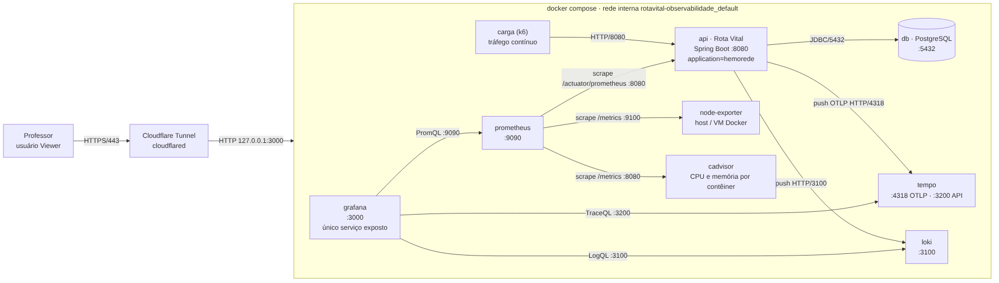

# Observabilidade — Rota Vital

Ambiente completo de observabilidade (Actuator + Prometheus + Grafana + Loki + Tempo) para a
entrega de Infraestrutura de Comunicação. Roda **separado** do deploy de produção no Render — o
Render continua só com `/actuator/health` exposto (veja `rotavital/src/main/resources/application-prod.yml`)
e sem tracing nem envio de logs. Este ambiente sobe a aplicação de novo, com o perfil padrão (não
`prod`), numa máquina dedicada só para a janela de correção.

## Arquitetura



Fonte editável: [`docs/arquitetura/diagramas/observabilidade.mmd`](../docs/arquitetura/diagramas/observabilidade.mmd).

## Pré-requisitos

- Uma máquina com Docker e o plugin Docker Compose instalados (`docker compose version`).
- No Docker Desktop (Windows/macOS), o Node Exporter e o cAdvisor medem a VM Linux do Docker, não
  o sistema operacional da máquina — comportamento aceito pelo enunciado, desde que explicado.
- O cAdvisor lê os contêineres direto do containerd do Docker (namespace `moby`): no Docker 29 /
  Docker Desktop as imagens ficam no containerd e o leitor "docker" do cAdvisor não as encontra.
  Por isso os painéis por contêiner agrupam pela imagem (`image`), não pelo nome do contêiner.
- Acesso remoto só pelo Grafana (porta 3000) — API, banco, Prometheus, Loki e Tempo ficam na rede
  interna do Compose, sem porta publicada.

## Subir o ambiente

```bash
cd observabilidade
cp .env.example .env   # edite POSTGRES_PASSWORD, JWT_SECRET, DEMO_SENHA e GRAFANA_PASSWORD
docker compose up -d --build
docker compose ps       # confirma que todos os serviços estão healthy/running
```

## Portas e URLs

| Serviço | Acesso | Observação |
|---|---|---|
| Grafana | `http://localhost:3000` (local) ou a URL do túnel | Único serviço exposto pra internet |
| API (rotavital) | rede interna (`api:8080`) | Sem porta publicada — R5 do enunciado |
| Prometheus | `http://localhost:9090` (só na própria máquina) | Porta presa em `127.0.0.1`; nunca exposto pela internet |
| Loki | rede interna (`loki:3100`) | Recebe push HTTP da própria aplicação |
| Tempo | rede interna (`tempo:3200`, OTLP em `4317`/`4318`) | Recebe traces via OTLP da aplicação |

## Onde rodar: máquina local + Cloudflare Tunnel

A ideia original era uma VM gratuita (Oracle Cloud Always Free), mas a capacidade Always Free
esgotou na região disponível (tanto o shape ARM quanto o x86) no momento desta entrega — decisão
registrada no [ADR 0005](../docs/arquitetura/adr/0005-observabilidade-stack.md). Alternativa
usada: rodar numa máquina já disponível (com Docker) e expor só o Grafana pela internet com o
**Cloudflare Tunnel**, sem precisar de VM nem abrir porta no roteador.

1. Baixe o binário `cloudflared` (não precisa instalar nada):
   `https://github.com/cloudflare/cloudflared/releases/latest` (Windows/macOS/Linux).
2. Suba o ambiente (seção "Subir o ambiente" acima).
3. Com o Grafana respondendo em `http://localhost:3000`, rode o túnel rápido:
   ```bash
   cloudflared tunnel --url http://localhost:3000
   ```
4. O `cloudflared` imprime uma URL pública (`https://algo-aleatorio.trycloudflare.com`) — essa é
   a URL a informar ao professor. **Importante:** essa URL muda a cada vez que o túnel reinicia
   (túnel rápido, sem domínio fixo); se precisar de uma URL estável, é preciso um domínio próprio
   configurado no Cloudflare (fora do escopo desta entrega).
5. A máquina e o comando `cloudflared tunnel` precisam ficar rodando durante toda a janela de
   correção.

### Alternativa: VM gratuita em nuvem (se a capacidade Always Free estiver disponível)

1. Criar a instância: shape `VM.Standard.A1.Flex` (Always Free, até 4 OCPUs/24 GB) ou
   `VM.Standard.E2.1.Micro` (x86, 1 OCPU/1 GB — considerar swap), imagem Ubuntu LTS mais recente.
2. Instalar Docker + Compose plugin (`curl -fsSL https://get.docker.com | sh`).
3. Abrir a porta 3000 em **dois** lugares (os dois bloqueiam por padrão):
   - Security List/Network Security Group da VCN (Oracle Cloud), regra de entrada TCP 3000.
   - Firewall do próprio SO (`sudo ufw allow 3000/tcp`).
4. Clonar o repositório, copiar `.env.example` para `.env` e preencher os valores.
5. `docker compose up -d --build`.

## Dashboards

Os dashboards próprios **Aplicação** (HTTP, JVM, HikariCP e as 3 métricas de negócio) e
**Infraestrutura** (host e contêineres) estão versionados em `grafana/dashboards/` e sobem
sozinhos pelo provisionamento (pasta "Projeto Integrador" no Grafana), sem passo manual.

Opcional, como complemento: importar os dashboards públicos **4701** (JVM Micrometer), **1860**
(Node Exporter Full) e **14282** (cAdvisor) em **Dashboards → New → Import**.

### Consultas PromQL dos painéis próprios

| Painel | Consulta |
|---|---|
| Requisições por segundo, por rota | `sum by (uri) (rate(http_server_requests_seconds_count{application="hemorede"}[1m]))` |
| Latência p95 | `histogram_quantile(0.95, sum by (le) (rate(http_server_requests_seconds_bucket{application="hemorede"}[5m])))` |
| Taxa de erros (4xx e 5xx) | `sum by (status) (rate(http_server_requests_seconds_count{application="hemorede", status=~"4..\|5.."}[5m]))` |
| Heap da JVM em uso | `sum(jvm_memory_used_bytes{application="hemorede", area="heap"})` |
| Pool HikariCP (conexões ativas) | `hikaricp_connections_active{application="hemorede"}` |
| CPU do host (%) | `100 - (avg(rate(node_cpu_seconds_total{mode="idle"}[5m])) * 100)` |
| CPU por contêiner | `label_replace(sum by (image) (rate(container_cpu_usage_seconds_total{image!=""}[1m])), "servico", "$1", "image", "(?:.*/)?([^/:]+)(?::.*)?")` |

### Métricas de negócio (ponto adicional)

| Métrica | Tipo | Consulta sugerida no painel |
|---|---|---|
| `hemorede_requisicoes_criadas_total` | Counter | `rate(hemorede_requisicoes_criadas_total[5m]) * 60` (requisições/min) |
| `hemorede_requisicoes_alocacao_seconds` | Timer | `rate(hemorede_requisicoes_alocacao_seconds_sum[5m]) / rate(hemorede_requisicoes_alocacao_seconds_count[5m])` (tempo médio) |
| `hemorede_estoque_bolsas_disponiveis` | Gauge | `hemorede_estoque_bolsas_disponiveis` (valor atual) |

## Gerar carga durante a correção

O serviço `carga` (k6) sobe junto com o `docker compose up -d` e fica gerando tráfego o tempo todo
(o script roda 30 min e o `restart: unless-stopped` o reinicia). Ele usa a `DEMO_SENHA` do `.env`
e gera tanto o caminho feliz (cria e aprova requisições, alimentando as métricas de negócio)
quanto casos de erro (404 de requisição inexistente e 422 de estoque insuficiente), que aparecem no painel de erros 4xx/5xx; o 422 também gera log `WARN` com `traceId` no Loki.

```bash
docker compose logs -f carga   # acompanhar a carga
docker compose stop carga      # pausar, se precisar
```

## Acesso remoto do professor

1. No Grafana, **Administration → Users** → criar um usuário com papel **Viewer**.
2. Informar ao professor a URL do túnel (`https://....trycloudflare.com`), o usuário e a senha
   **só pelo PDF ou pela atividade do Google Classroom** — nunca no repositório.
3. Manter o serviço `carga` **e** o `cloudflared tunnel` rodando durante a
   janela de correção para os painéis terem dado em tempo real e o acesso continuar no ar.

## Verificação rápida

```bash
docker compose ps                                                    # tudo healthy/running
docker compose exec api curl -s http://localhost:8080/actuator/prometheus | grep hemorede_
# Prometheus: http://localhost:9090/targets, todos UP
# Grafana -> Explore -> Loki: {application="hemorede"}
# Grafana -> Explore -> Tempo: um trace de POST /api/requisicoes/{id}/aprovar
```
